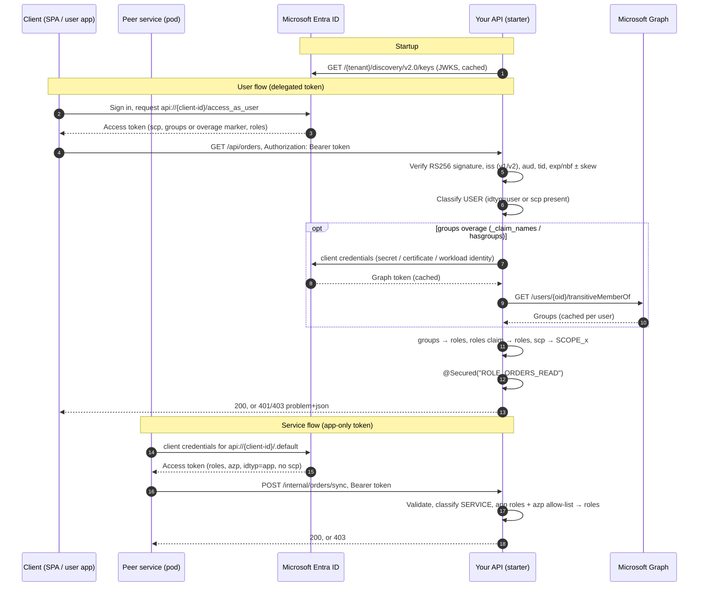

# spring-security-jwt-starter

[](https://github.com/rmkr-dev/spring-security-jwt-starter/actions/workflows/ci.yml)
[](LICENSE)

A reusable Spring Boot 3.x (Java 17 and 21) security starter for **Microsoft Entra ID** (Azure AD).
It works with app registrations and enterprise applications, for **users** (delegated tokens) and
**services** (app-only, client-credentials tokens), on Spring MVC and on **WebFlux**, and it calls downstream APIs
as the service or **on behalf of the user**.

A service adds one dependency, supplies configuration (ConfigMap, env or properties), and writes:

```java
@GetMapping("/api/orders")
@Secured("ROLE_ORDERS_READ")
public List<Order> orders() { ... }
```

## Contents

- [Modules](#modules)
- [Quickstart](#quickstart)
- [How it works](#how-it-works)
- [User flow](#user-flow)
- [Service flow](#service-flow)
- [Calling other services](#calling-other-services)
- [Calling APIs as the user (on-behalf-of)](#calling-apis-as-the-user-on-behalf-of)
- [Reactive (WebFlux)](#reactive-webflux)
- [Entra ID setup](#entra-id-setup)
- [Kubernetes](#kubernetes)
- [Configuration reference](#configuration-reference)
- [Security defaults](#security-defaults)
- [Observability](#observability)
- [Customising](#customising)
- [Testing your service](#testing-your-service)
- [Building](#building)
- [Roadmap](#roadmap)

## Modules

| Module | Purpose |
| --- | --- |
| `entra-security-core` | Framework-level pieces: JWT decoder and validators, user/service classification, authority mapping, Graph group lookup, token acquisition (secret, certificate, workload identity) with client credentials and on-behalf-of, outbound interceptors, problem-details handlers, `EntraPrincipal`. |
| `entra-security-spring-boot-starter` | Auto-configuration (`AutoConfiguration.imports`), `entra.security.*` properties with validation, the default `SecurityFilterChain` (servlet) or `SecurityWebFilterChain` (WebFlux), `@EnableEntraSecurity`, `EntraOutboundClients`, optional Actuator health and Micrometer metrics. |
| `entra-security-test` | Test support for consuming services: an in-process mock Entra authority (JWKS, token endpoint with client credentials and on-behalf-of, Graph), signed test tokens, `@AutoConfigureEntraMockAuthority`, `@WithMockEntraUser` and `@WithMockEntraService`. |
| `sample-api` | Example service with user and service endpoints, an outbound client and Kubernetes manifests (`sample-api/k8s`). |
| `sample-reactive-api` | The same service on WebFlux (no servlet API on the classpath), tested with `WebTestClient`. |

## Quickstart

### 1. Add the dependency

```xml
<dependency>
    <groupId>io.github.rmkr-dev</groupId>
    <artifactId>entra-security-spring-boot-starter</artifactId>
    <version>0.5.0</version>
</dependency>
```

Your service also needs `spring-boot-starter-web`, or `spring-boot-starter-webflux` for a reactive service
(see [Reactive (WebFlux)](#reactive-webflux)). Until the artifacts are published to Maven Central, build
them locally with `mvn install`.

### 2. Configure

Minimal `application.yaml`:

```yaml
entra:
  security:
    tenant-id: 00000000-0000-0000-0000-000000000000   # Directory (tenant) ID
    client-id: 11111111-1111-1111-1111-111111111111   # This API's Application (client) ID
    group-role-mappings:
      "aaaaaaaa-aaaa-aaaa-aaaa-aaaaaaaaaaaa": [ORDERS_READ]
```

or just environment variables for the required values:

```bash
ENTRA_SECURITY_TENANTID=00000000-0000-0000-0000-000000000000
ENTRA_SECURITY_CLIENTID=11111111-1111-1111-1111-111111111111
```

### 3. Secure endpoints

```java
@SpringBootApplication
@EnableEntraSecurity          // optional, see below
public class OrdersApplication { ... }

@RestController
class OrderController {

    @GetMapping("/api/orders")
    @Secured("ROLE_ORDERS_READ")
    List<Order> list() { ... }

    @PostMapping("/api/orders")
    @PreAuthorize("hasRole('ORDERS_WRITE')")
    Order create(@RequestBody Order order, EntraPrincipal caller) { ... }
}
```

That's it: every path except the public ones needs a valid Entra token, and roles come from your
mappings.

**`@EnableEntraSecurity`** is optional; the auto-configuration already secures the app and enables
method security. The annotation makes it explicit and also:

- enables `@Secured`/`@PreAuthorize`/`@RolesAllowed` even if `entra.security.method-security.enabled=false`
  (on WebFlux, reactive method security with `@Secured`/`@PreAuthorize`);
- preloads the security context at startup: the tenant JWKS is fetched eagerly and the effective
  configuration is logged;
- with `@EnableEntraSecurity(failOnJwksError = true)`, startup fails if the signing keys cannot be loaded.

### The caller: `EntraPrincipal`

```java
@GetMapping("/api/me")
EntraPrincipal me(EntraPrincipal principal) { return principal; }   // or @AuthenticationPrincipal
```

| Field | Meaning |
| --- | --- |
| `type` | `USER` or `SERVICE` |
| `objectId` | `oid`: user or service principal object id (`getName()`) |
| `appId` | calling client: `azp` (v2) or `appid` (v1) |
| `tenantId`, `subject`, `tokenVersion` | `tid`, `sub`, `ver` |
| `roles` | granted authorities, such as `ROLE_ORDERS_READ` |
| `appRoles`, `groups`, `scopes` | raw `roles`, groups (from the token or Graph), `scp` |
| `displayName`, `username` | `name`, `preferred_username`/`upn` (users) |

Helpers: `isUser()`, `isService()`, `hasRole("X")`, `hasAppRole("X")`, `isMemberOf(groupId)`.
Outside controllers, use `EntraPrincipals.current()`.

## How it works



## User flow

1. The token is validated (see [Security defaults](#security-defaults)).
2. It is a **user** token when `idtyp=user`, or when `idtyp` is absent and `scp` is present.
3. Roles are computed from:
   - **groups**: each value of the `groups` claim (object ids, or names when Entra emits
     `sAMAccountName`/cloud display names) is looked up in `group-role-mappings` (case-insensitive);
   - **app roles**: the `roles` claim, which holds app roles assigned to the user or their groups on
     the enterprise application, mapped through `app-role-mappings`, or used directly as
     `ROLE_<value>` (`user.include-roles-claim`, default `true`);
   - **scopes**: `scp` values become `SCOPE_<scope>` when `user.include-scopes=true`;
   - `user.default-roles` for every user.
4. **Group overage**: when a user is in more groups than fit in the token (200 for JWTs), Entra
   omits `groups` and adds `_claim_names: {"groups": ...}` (or `hasgroups: true`). With
   `graph.overage-enabled=true` the starter reads the user's transitive groups from Microsoft Graph
   with an app-only token, caches them per user (`graph.cache-ttl`), and maps ids **and** display
   names. If Graph fails, the request continues without group roles (fail closed) and a warning is
   logged.

## Service flow

1. It is a **service** token when `idtyp=app`, or when `idtyp` is absent and there is no `scp`.
2. Roles are computed from:
   - the `roles` claim (application permissions granted to the caller): `app-role-mappings`, or
     `ROLE_<value>` when `service.map-unmapped-app-roles=true` (default);
   - the caller's client id (`azp` for v2, `appid` for v1): `client-role-mappings`;
   - `service.default-roles`.
3. `service.require-known-client=true` rejects (401) app-only tokens whose client id is not a key
   of `client-role-mappings`.

`client-role-mappings` apply to app-only tokens only, so a user token issued to the same client id
cannot pick them up.

## Calling other services

Configure outbound clients and use the interceptor:

```yaml
entra:
  security:
    credential:
      type: workload-identity        # or client-secret / certificate
    outbound:
      clients:
        inventory-api:
          scope: api://dddddddd-dddd-dddd-dddd-dddddddddddd/.default
          base-url: http://inventory-api.inventory.svc.cluster.local
```

```java
@Component
class InventoryClient {
    private final RestClient rest;

    InventoryClient(RestClient.Builder builder, EntraOutboundClients outbound) {
        this.rest = builder.baseUrl(outbound.baseUrl("inventory-api"))
                .requestInterceptor(outbound.interceptor("inventory-api"))
                .build();
    }
}

// WebClient
WebClient.builder().filter(EntraWebClientSupport.filter(outbound, "inventory-api")).build();
```

Tokens are cached per scope and renewed `cache.token-refresh-skew` before expiry.

| Credential type | Settings | Notes |
| --- | --- | --- |
| `client-secret` | `client-secret` | Supply it from a Kubernetes Secret. |
| `certificate` | `certificate-path`, `certificate-password` | PEM (certificate + unencrypted PKCS#8 key) or `.p12`/`.pfx`. Sends an RS256 client assertion with `x5t`. |
| `workload-identity` | `federated-token-file` (optional) | AKS Workload Identity. Uses `AZURE_FEDERATED_TOKEN_FILE`, `AZURE_CLIENT_ID`, `AZURE_TENANT_ID` and `AZURE_AUTHORITY_HOST` from the webhook unless set explicitly. The file is re-read on each token request. |

Each outbound client can override `credential.*`; otherwise it uses `entra.security.credential`.

## Calling APIs as the user (on-behalf-of)

When your API has to call another API **as the signed-in user** (so the downstream API sees the user, their
scopes and their permissions, not your service), use the on-behalf-of (OBO) flow. The starter exchanges the
user's incoming token for a downstream token with Entra's `jwt-bearer` grant, authenticated with your API's
credential (client secret, certificate or workload identity), and adds it to the outgoing request.

```yaml
entra:
  security:
    credential:
      type: workload-identity        # or client-secret / certificate
    outbound:
      clients:
        profile-api:
          flow: on-behalf-of
          scope: api://eeeeeeee-eeee-eeee-eeee-eeeeeeeeeeee/Profile.Read   # delegated scopes, or .../.default
          base-url: http://profile-api.profile.svc.cluster.local
```

The same helpers as for app-only clients pick the flow from configuration:

```java
// Spring MVC: RestClient (the user comes from the SecurityContextHolder of the request thread)
RestClient profile = builder.baseUrl(outbound.baseUrl("profile-api"))
        .requestInterceptor(outbound.interceptor("profile-api"))
        .build();

// WebFlux: WebClient (the user comes from the Reactor context, so keep the call in the request's chain)
WebClient profile = webClientBuilder.baseUrl(outbound.baseUrl("profile-api"))
        .filter(EntraWebClientSupport.filter(outbound, "profile-api"))
        .build();

// Or get the token yourself
AccessToken token = outbound.token("profile-api");              // current user
AccessToken token = outbound.token("profile-api", userJwt);     // a given user token
```

How it behaves:

- **Request**: `grant_type=urn:ietf:params:oauth:grant-type:jwt-bearer`, `assertion=<incoming token>`,
  `requested_token_use=on_behalf_of`, the configured `scope` and the client authentication of the credential.
  The client id is `entra.security.client-id` (or the client's `credential.client-id`), because Entra only
  exchanges a token for the application it was issued to. With workload identity, add the federated
  credential to this API's own app registration.
- **Cache**: one token per user and scope. The key is a SHA-256 hash of the user's `oid` (or `sub`), `tid` and
  the normalized scope, so neither the incoming token nor user ids are stored as keys. A user's next request
  reuses the token even though its incoming token is different. Tokens are renewed
  `cache.token-refresh-skew` before they expire (at most halfway through their lifetime); if Entra cannot be
  reached during a renewal, the cached token is used until it actually expires. The cache holds at most
  `cache.on-behalf-of-max-entries` tokens per client.
- **Only user tokens**: a request authenticated with an app-only token is refused before anything is sent
  (`EntraTokenAcquisitionException`, `error=invalid_request`). Use a client-credentials client for service callers.
- **Consent and Conditional Access**: when Entra answers that the user has not consented (`AADSTS65001`) or must
  satisfy MFA or another policy (`interaction_required`, a claims challenge), the call fails with
  `EntraInteractionRequiredException`. Thrown from a controller (servlet or WebFlux), it becomes a **403**
  problem document that the client app can act on:

  ```http
  HTTP/1.1 403 Forbidden
  WWW-Authenticate: Bearer error="consent_required", error_description="..."
  Content-Type: application/problem+json

  {"type":"about:blank","title":"Forbidden","status":403,
   "detail":"A downstream API needs consent that the user has not granted; sign in again interactively and consent",
   "instance":"/api/profile","error":"consent_required","scope":"api://eeeeeeee-.../Profile.Read"}
  ```

  For a Conditional Access challenge, `error` is `interaction_required` and the body carries `claims`; the
  `WWW-Authenticate` header carries it base64-encoded as `claims="..."`, which MSAL clients pass to the next
  interactive sign-in. Other failures (`invalid_client`, Entra unreachable) stay `EntraTokenAcquisitionException`
  and surface as server errors.
- **Threads**: the user token is read from the security context, so call OBO clients while handling the
  request. On another thread (`@Async`, your own executor), pass the token with `outbound.token(name, jwt)`.
- Token-endpoint calls are counted in `entra.security.token.acquisitions` with `grant=on_behalf_of`.

Entra setup: the client app (SPA, mobile app) requests a token for **your** API; your app registration has
delegated API permissions to the downstream API, and the user or an admin has consented to them (list the client
app under `knownClientApplications` to get combined consent). See
[the Microsoft OBO documentation](https://learn.microsoft.com/entra/identity-platform/v2-oauth2-on-behalf-of-flow).

## Reactive (WebFlux)

The starter detects a reactive web application (`spring-boot-starter-webflux` without Spring MVC, or
`spring.main.web-application-type=reactive`) and configures a WebFlux resource server instead of the
servlet one. Nothing changes in your configuration: the same `entra.security.*` properties, the same
mappings and the same `@EnableEntraSecurity`.

```java
@SpringBootApplication
@EnableEntraSecurity
public class OrdersApplication { ... }

@RestController
class OrderController {

    @GetMapping("/api/orders")
    @Secured("ROLE_ORDERS_READ")
    Flux<Order> list() { ... }

    @PostMapping("/api/orders")
    @PreAuthorize("hasRole('ORDERS_WRITE')")
    Mono<Order> create(@RequestBody Order order, EntraPrincipal caller) { ... }

    @GetMapping("/api/me")
    Mono<EntraPrincipal> me(Mono<EntraPrincipal> caller) { return caller; }
}
```

What you get, compared with the servlet stack:

| | Servlet | WebFlux |
| --- | --- | --- |
| Filter chain | `SecurityFilterChain` `entraSecurityFilterChain` | `SecurityWebFilterChain` `entraSecurityWebFilterChain` |
| Token validation | `JwtDecoder` | `ReactiveJwtDecoder` (`EntraReactiveJwtDecoder`): the same decoder, validators and JWKS cache, so the same tokens are accepted and rejected |
| Role mapping | `EntraJwtAuthenticationConverter` | `ReactiveEntraJwtAuthenticationConverter`: same classification, group/app-role/client mappings and client allow-list |
| Group overage | `GroupMembershipResolver` (`RestClient`) | `ReactiveGroupMembershipResolver` (`WebClient`), cached per user, failing closed |
| 401 / 403 | `ProblemDetailsAuthenticationEntryPoint`, `ProblemDetailsAccessDeniedHandler` | `ServerProblemDetailsAuthenticationEntryPoint`, `ServerProblemDetailsAccessDeniedHandler`: identical status, `WWW-Authenticate` header and problem-details body |
| Method security | `@EnableMethodSecurity`: `@Secured`, `@PreAuthorize`, `@RolesAllowed` | `@EnableReactiveMethodSecurity`: `@PreAuthorize`/`@PostAuthorize`, plus `@Secured` added by the starter |
| Caller | `EntraPrincipal` parameter, `@AuthenticationPrincipal`, `EntraPrincipals.current()` | `EntraPrincipal` or `Mono<EntraPrincipal>` parameter, `@AuthenticationPrincipal`, `ReactiveEntraPrincipals.current()` |
| Customising the chain | `EntraHttpSecurity` | `EntraServerHttpSecurity` |

Notes:

- Reactive method security only intercepts methods that return a `Publisher` (`Mono`/`Flux`), as in
  Spring Security. `@RolesAllowed` (JSR-250) is not supported on WebFlux; use `@Secured` or `@PreAuthorize`.
- `@EnableEntraSecurity` enables `@EnableReactiveMethodSecurity` in a reactive application (and
  `@EnableMethodSecurity` otherwise), so you never get servlet interceptors that cannot see the reactive
  security context. Adding `@EnableReactiveMethodSecurity` yourself works too, and `@Secured` is added to it.
  `mode = ASPECTJ` applies to servlet applications only.
- Validation, the Graph lookup and client-credentials token acquisition can block on the network (JWKS
  refresh, token endpoint), so they run on `Schedulers.boundedElastic()`, never on the event loop.
- An application-defined blocking `GroupMembershipResolver` bean is still used: it is adapted onto
  `boundedElastic`. Define a `ReactiveGroupMembershipResolver` bean to replace the Graph lookup outright.
- Your own `SecurityWebFilterChain` makes the default one back off. Reuse the Entra setup with
  `EntraServerHttpSecurity`:

  ```java
  @Bean
  SecurityWebFilterChain api(ServerHttpSecurity http, EntraServerHttpSecurity entra) {
      http.securityMatcher(ServerWebExchangeMatchers.pathMatchers("/api/**"));
      return entra.configure(http).build();
  }
  ```

- Actuator health (`entraJwks`, `entraGraph`) and the `entra.security.*` meters work the same way.
- A full example is in [`sample-reactive-api`](sample-reactive-api).

## Entra ID setup

### 1. App registration for the API

1. **Entra admin center → App registrations → New registration**, single tenant. Note the
   **Application (client) ID** and **Directory (tenant) ID**.
2. **Expose an API**: set the Application ID URI to `api://<client-id>`, and add a scope such as
   `access_as_user` for delegated (user) access.
3. *(Optional, recommended)* **Manifest**: set `"requestedAccessTokenVersion": 2`
   (`accessTokenAcceptedVersion` in older manifests). Both v1 and v2 tokens are accepted either way.

### 2. App roles

**App roles → Create app role** for each permission:

| Display name | Value | Allowed member types | Used by |
| --- | --- | --- | --- |
| Orders writer | `ORDERS_WRITE` | Users/Groups | users, through the enterprise app |
| Orders sync | `Orders.Sync` | Applications | peer services (client credentials) |

Map values with `app-role-mappings` (`"[Orders.Sync]": [ORDERS_SYNC]`) or use them directly
(`@Secured("ROLE_ORDERS_WRITE")`).

### 3. Groups claim

**Token configuration → Add groups claim**: choose *Security groups* (or *Groups assigned to the
application*, which keeps tokens small and avoids overage). For the **Access** token, keep *Group ID*,
or emit names (`sAMAccountName` for synced groups, or *cloud-only group display names*) and map names
instead of ids.

For overage, grant the API's app registration the **Microsoft Graph application permission
`GroupMember.Read.All`** (admin consent) and configure `entra.security.credential`.

### 4. Enterprise application assignment

**Enterprise applications → your API → Users and groups → Add user/group** assigns app roles to users
or groups; they appear in the user's `roles` claim. Turn on **Properties → Assignment required** to
let only assigned users get tokens for the API.

### 5. Service callers

For each peer service (its own app registration or a managed identity):

1. On the **API** registration, the peer is granted an app role: in the peer's registration, **API
   permissions → Add a permission → My APIs → your API → Application permissions → `Orders.Sync`**,
   then **Grant admin consent**. For managed identities, assign the app role with Graph or the CLI
   (`appRoleAssignedTo`).
2. The peer requests `api://<api-client-id>/.default` with client credentials.
3. Optionally list the peer's client id in `client-role-mappings`, and set
   `service.require-known-client=true` to allow only listed clients.

### 6. Workload identity (AKS)

1. Enable OIDC issuer and workload identity on the cluster.
2. Create a federated credential on the app registration (or user-assigned managed identity) for
   `system:serviceaccount:<namespace>:<service-account>`.
3. Annotate the service account with `azure.workload.identity/client-id` and label pods with
   `azure.workload.identity/use: "true"` (see `sample-api/k8s/deployment.yaml`).

## Kubernetes

Non-secret configuration in a ConfigMap mounted as a file, secrets as a configtree:

```yaml
# ConfigMap: mounted at /config, imported with spring.config.import=optional:file:/config/application.yaml
apiVersion: v1
kind: ConfigMap
metadata:
  name: orders-api-entra
data:
  application.yaml: |
    entra:
      security:
        tenant-id: "00000000-0000-0000-0000-000000000000"
        client-id: "11111111-1111-1111-1111-111111111111"
        group-role-mappings:
          "aaaaaaaa-aaaa-aaaa-aaaa-aaaaaaaaaaaa": [ORDERS_READ]
          "bbbbbbbb-bbbb-bbbb-bbbb-bbbbbbbbbbbb": [ORDERS_READ, ORDERS_WRITE]
        app-role-mappings:
          "[Orders.Sync]": [ORDERS_SYNC]
        graph:
          overage-enabled: true
        credential:
          type: client-secret
---
# Secret: mounted at /etc/entra, imported with spring.config.import=optional:configtree:/etc/entra/
apiVersion: v1
kind: Secret
metadata:
  name: orders-api-entra
type: Opaque
stringData:
  entra.security.credential.client-secret: "<client-secret>"
```

```yaml
# application.yaml in the service image
spring:
  config:
    import:
      - optional:file:/config/application.yaml
      - optional:configtree:/etc/entra/
```

Full manifests: [`sample-api/k8s`](sample-api/k8s).

**Environment variables** work for scalar values: `ENTRA_SECURITY_TENANTID`, `ENTRA_SECURITY_CLIENTID`,
`ENTRA_SECURITY_CLOCKSKEW=90s`, `ENTRA_SECURITY_GRAPH_OVERAGEENABLED=true`,
`ENTRA_SECURITY_CREDENTIAL_CLIENTSECRET` (from `secretKeyRef`). Map keys such as group GUIDs cannot be
written as env var names, so put mappings in the ConfigMap file or in `SPRING_APPLICATION_JSON`:

```bash
SPRING_APPLICATION_JSON='{"entra":{"security":{"group-role-mappings":{"aaaaaaaa-aaaa-aaaa-aaaa-aaaaaaaaaaaa":["ORDERS_READ"]}}}}'
```

> Map keys with characters other than letters, digits and `-` (such as `Orders.Sync` or group names
> with spaces) must be wrapped in brackets in YAML: `"[Orders.Sync]"`, `"[Order Admins]"`.

## Configuration reference

All properties are under `entra.security`. Invalid configuration stops startup with a message that
names the property.

| Property | Default | Description |
| --- | --- | --- |
| `enabled` | `true` | Turn the starter off. |
| `tenant-id` | **required** | Directory (tenant) ID. A GUID unless `issuers` is set; `common`/`organizations` are rejected. |
| `client-id` | **required** | Application (client) ID of the API. |
| `authority-host` | `https://login.microsoftonline.com` | Authority host (change for sovereign clouds). |
| `jwk-set-uri` | `{authority-host}/{tenant-id}/discovery/v2.0/keys` | JWKS endpoint. |
| `audiences` | `api://{client-id}`, `{client-id}` | Accepted `aud` values. |
| `issuers` | `{authority-host}/{tenant-id}/v2.0`, `https://sts.windows.net/{tenant-id}/` | Accepted `iss` values (exact match). |
| `require-tenant-match` | `true` | Require `tid` = `tenant-id`. |
| `clock-skew` | `60s` | Tolerance for `exp`/`nbf`. |
| `public-paths` | `/actuator/health`, `/actuator/health/**`, `/actuator/info` | Paths that need no token. |
| `group-role-mappings` | — | Group id or name → roles. |
| `app-role-mappings` | — | App role value (`roles` claim) → roles. |
| `client-role-mappings` | — | Client id (`azp`/`appid`) → roles, for app-only tokens. |
| `user.include-roles-claim` | `true` | Map the `roles` claim of user tokens. |
| `user.include-scopes` | `false` | Grant `SCOPE_<scp>` authorities. |
| `user.default-roles` | — | Roles for every user. |
| `service.map-unmapped-app-roles` | `true` | Unmapped app roles become `ROLE_<value>`. |
| `service.require-known-client` | `false` | Reject app-only tokens from clients not in `client-role-mappings`. |
| `service.default-roles` | — | Roles for every service caller. |
| `graph.overage-enabled` | `false` | Resolve overage groups through Graph (needs `credential`). |
| `graph.base-url` | `https://graph.microsoft.com` | Graph endpoint. |
| `graph.scope` | `https://graph.microsoft.com/.default` | Graph token scope. |
| `graph.cache-ttl` | `10m` | Group cache lifetime per user. |
| `graph.cache-max-entries` | `10000` | Group cache size. |
| `graph.max-pages` | `20` | Max Graph pages per lookup. |
| `credential.type` | `none` | `none`, `client-secret`, `certificate`, `workload-identity`. |
| `credential.tenant-id` / `client-id` | API values (or `AZURE_*` for workload identity) | Identity requesting tokens. |
| `credential.client-secret` | — | Client secret. |
| `credential.certificate-path` / `certificate-password` | — | PEM or PKCS#12 certificate. |
| `credential.federated-token-file` | `$AZURE_FEDERATED_TOKEN_FILE` | Workload identity token file. |
| `outbound.clients.<name>.flow` | `client-credentials` | `client-credentials` (app-only) or `on-behalf-of` (as the calling user). |
| `outbound.clients.<name>.scope` | **required** | Scope for the peer: `api://<peer>/.default`, or delegated scopes such as `api://<peer>/Orders.Read` for `on-behalf-of`. |
| `outbound.clients.<name>.base-url` | — | Peer base URL. |
| `outbound.clients.<name>.credential.*` | `entra.security.credential` | Per-client credential. |
| `cache.jwks-ttl` | `15m` | JWKS cache lifetime (unknown `kid`s trigger a rate-limited refresh). |
| `cache.token-refresh-skew` | `5m` | Renew acquired tokens this long before expiry. |
| `cache.on-behalf-of-max-entries` | `10000` | On-behalf-of tokens cached per outbound client (users × scopes). |
| `http.connect-timeout` / `read-timeout` | `5s` / `10s` | Timeouts for JWKS, token and Graph calls. |
| `method-security.enabled` | `true` | Enable `@Secured`/`@PreAuthorize`/`@RolesAllowed` (on WebFlux: `@Secured`/`@PreAuthorize`). |
| `logging.log-claims` | `false` | Log a privacy-safe claim summary at DEBUG. |

## Security defaults

- **Stateless** sessions, **CSRF off**, no form login, HTTP Basic, logout or request cache.
- **CORS** follows your `CorsConfigurationSource` bean or Spring MVC CORS configuration (nothing is
  allowed cross-origin by default). On WebFlux, a `CorsConfigurationSource` bean.
- Only **RS256** signatures, keys from the tenant JWKS; `none`, HS* and unknown keys are rejected.
- **Issuer** exact match (v1 and v2), **audience**, **tenant** (`tid`), `exp` required, `exp`/`nbf`
  with configurable **clock skew**.
- **401** and **403** responses are `application/problem+json` with a `WWW-Authenticate: Bearer` header:

  ```json
  {"type":"about:blank","title":"Forbidden","status":403,
   "detail":"The caller does not have a role required to access this resource",
   "instance":"/api/orders","error":"insufficient_scope"}
  ```

- **Safe logging**: with `logging.log-claims=true` and DEBUG on `io.github.rmkrdev.entra.security`,
  one line per request with type, truncated oid, appid, tid, issuer, roles and counts. Tokens, names
  and e-mail addresses are never logged.

## Observability

Health and metrics are optional. An application that does not depend on Actuator or Micrometer is
unchanged: the auto-configurations are `@ConditionalOnClass` and are not loaded.

Add Actuator when you want the health endpoint (it already brings Micrometer):

```xml
<dependency>
    <groupId>org.springframework.boot</groupId>
    <artifactId>spring-boot-starter-actuator</artifactId>
</dependency>
```

### Health

| Component | When it is registered | UP | DOWN |
| --- | --- | --- | --- |
| `entraJwks` | Actuator is on the classpath | The tenant JWKS can be fetched or read from cache and contains at least one RSA signing key | The JWKS cannot be loaded (`reason=unreachable`) or has no usable signing key (`reason=no_signing_keys`) |
| `entraGraph` | `entra.security.graph.overage-enabled=true` | An app-only token is acquired and `GET {graph.base-url}/v1.0/` succeeds | Token acquisition fails (`reason=token`), Graph rejects the credential (`reason=unauthorized`) or Graph cannot be reached (`reason=unreachable`) |

`entraGraph` is omitted when group overage is off, so it cannot fail `/actuator/health`. With
`management.endpoint.health.show-details=always` (or `when-authorized`) the components show under
those names. They are part of the default readiness group and are not part of liveness, so a JWKS
or Graph outage stops traffic without restarting the process.

`/actuator/health` stays public: the default `public-paths` are `/actuator/health`,
`/actuator/health/**` and `/actuator/info`. The metrics endpoint is not public.

### Metrics

Meters use the prefix `entra.security`. Tags are a fixed set: no object id, token, tenant, or group
id is ever a tag value.

| Meter | Type | Tags |
| --- | --- | --- |
| `entra.security.jwt.authentications` | counter | `result` (`success`/`failure`), `reason` |
| `entra.security.jwks.refreshes` | timer | `result` |
| `entra.security.graph.lookups` | timer | `result` |
| `entra.security.token.acquisitions` | timer | `result`, `credential` (`client_secret`, `certificate`, `workload_identity`), `grant` (`client_credentials`, `on_behalf_of`) |

`reason` on a successful authentication is `none`. Failures use `missing`, `expired`,
`not_yet_valid`, `invalid_issuer`, `invalid_audience`, `invalid_tenant`, `missing_claims`,
`invalid_signature`, `unknown_key`, `malformed`, `client_not_allowed` or `invalid_token`.
JWKS refreshes, Graph group lookups and token-endpoint calls are recorded only when this library
actually makes the HTTP call, not when it serves a cached key, group list or access token.
The Graph health probe is not a group lookup and does not increment `entra.security.graph.lookups`.

## Customising

- Define your own `SecurityFilterChain` and the default one backs off. Reuse the Entra setup with
  `EntraHttpSecurity`:

  ```java
  @Bean
  SecurityFilterChain api(HttpSecurity http, EntraHttpSecurity entra) throws Exception {
      http.securityMatcher("/api/**");
      return entra.configure(http).build();
  }
  ```

- Replace any bean (`JwtDecoder`, `EntraAuthorityMapper`, `GroupMembershipResolver`,
  `EntraJwtAuthenticationConverter`, the problem-details handlers, `InteractionRequiredExceptionHandler`): they
  are all `@ConditionalOnMissingBean`. On WebFlux the same goes for `ReactiveJwtDecoder`,
  `ReactiveGroupMembershipResolver`, `ReactiveEntraJwtAuthenticationConverter`, the `Server*` handlers and
  `ServerInteractionRequiredExceptionHandler`.

## Testing your service

Add the test module next to the starter:

```xml
<dependency>
    <groupId>io.github.rmkr-dev</groupId>
    <artifactId>entra-security-test</artifactId>
    <version>0.5.0</version>
    <scope>test</scope>
</dependency>
```

It gives you two ways to test `@Secured` endpoints, and neither needs a real tenant or network access.

### Real tokens against a mock authority

`@AutoConfigureEntraMockAuthority` starts an in-process authority on a random loopback port (one per JVM, so
Spring's context cache keeps working) and points `entra.security.authority-host`, `jwk-set-uri` and
`graph.base-url` at it. Tokens are signed with its RSA key, so the full pipeline runs: signature, issuer,
audience, tenant, expiry, role mapping and the Graph lookup on group overage.

```java
@SpringBootTest
@AutoConfigureMockMvc
@AutoConfigureEntraMockAuthority
class OrderApiTest {

    @Autowired MockMvc mvc;
    @Autowired EntraTestTokens tokens;          // bound to your tenant-id and client-id
    @Autowired EntraMockAuthority authority;

    @Test
    void readersCanList() throws Exception {
        mvc.perform(get("/api/orders").with(bearer(tokens.user().groups(READERS_GROUP))))
           .andExpect(status().isOk());
    }

    @Test
    void peersCanSync() throws Exception {
        mvc.perform(post("/internal/orders/sync").with(bearer(tokens.service().appRoles("Orders.Sync"))))
           .andExpect(status().isOk());
    }

    @Test
    void usersInManyGroupsAreResolvedThroughGraph() throws Exception {
        authority.registerGroups(USER_OID, READERS_GROUP);
        mvc.perform(get("/api/orders").with(bearer(tokens.user().objectId(USER_OID).groupOverage())))
           .andExpect(status().isOk());
    }

    @Test
    void expiredTokensAreRejected() throws Exception {
        mvc.perform(get("/api/orders").with(bearer(tokens.user().groups(READERS_GROUP).expired())))
           .andExpect(status().isUnauthorized());
    }
}
```

`bearer(...)` comes from `EntraMockMvc`; outside MockMvc use `tokens.user().bearer()` as the
`Authorization` header value. The token builder covers what Entra emits:

| Builder call | Token |
| --- | --- |
| `tokens.user()` | v2 delegated token, `scp=access_as_user`, default `oid` and client |
| `tokens.service()` | v2 app-only token, `idtyp=app`, no `scp` |
| `.groups(...)`, `.appRoles(...)`, `.scopes(...)` | `groups`, `roles`, `scp` |
| `.objectId(...)`, `.appId(...)`, `.name(...)`, `.username(...)` | `oid`, `azp`/`appid`, `name`, `preferred_username`/`upn` |
| `.groupOverage()` | no `groups`, `_claim_names`/`_claim_sources` pointing at Graph |
| `.v1()` | `sts.windows.net` issuer, `appid`, `api://` audience, `ver=1.0` |
| `.expired()`, `.expiresIn(...)`, `.notBefore(...)` | lifetime |
| `.audience(...)`, `.issuer(...)`, `.tenantId(...)`, `.without(claim)` | negative tests |
| `.signedWithUnknownKey()`, `.signedWithHmac()` | signatures that must be rejected |

The authority also serves the token endpoint, so outbound clients and the Graph client get tokens without
any extra stubbing. Use `EntraMockAuthority.start()` directly (and close it) when you are not in a Spring test.

### On-behalf-of calls

The mock token endpoint also answers the on-behalf-of grant. It checks the assertion like Entra does (signed by
the mock authority, unexpired, a user token, issued to the requesting `client_id`) and returns a delegated token
for the same user: `aud` is the resource of the requested scope, `scp` the scope names, `azp` your API, and
`oid`, `sub`, `name` and `preferred_username` copied from the user's token. Point the downstream base URL at a
stub and assert on what arrives:

```java
@Test
void profileIsReadAsTheUser() throws Exception {
    mvc.perform(get("/api/profile").with(bearer(tokens.user().objectId(USER_OID))))
       .andExpect(status().isOk());
    assertThat(authority.onBehalfOfRequests()).isEqualTo(1);
}

@Test
void missingConsentIsA403() throws Exception {
    authority.requireConsent("api://profile-api");                 // a scope or a whole resource
    mvc.perform(get("/api/profile").with(bearer(tokens.user())))
       .andExpect(status().isForbidden())
       .andExpect(jsonPath("$.error").value("consent_required"));
}
```

`requireInteraction(scopeOrResource, claims)` answers `interaction_required` with a claims challenge,
`onBehalfOfTokenLifetime(...)` shortens token lifetimes for refresh tests, and `onBehalfOfRequestForms()` returns
the received forms with the assertion and secrets masked. `reset()` clears all of it. On-behalf-of needs a real
token: `@WithMockEntraUser` has none to exchange, so use `bearer(...)` for these tests.

### No token at all

For tests that only care about authorization, run the test as a user or a service:

```java
@Test
@WithMockEntraUser(groups = READERS_GROUP)
void readersCanList() throws Exception {
    mvc.perform(get("/api/orders")).andExpect(status().isOk());
}

@Test
@WithMockEntraService(appRoles = "Orders.Sync")
void peersCanSync() throws Exception {
    mvc.perform(post("/internal/orders/sync")).andExpect(status().isOk());
}
```

When the starter is in the test context, the annotation values go through the same
`EntraJwtAuthenticationConverter` as real requests, so your `group-role-mappings`, `app-role-mappings` and
`client-role-mappings` are tested too. `roles = "ADMIN"` adds `ROLE_ADMIN` on top. `EntraPrincipal`
injection, `@AuthenticationPrincipal` and `EntraPrincipals.current()` all work.

### WebFlux with `WebTestClient`

Everything above works for reactive services. Use `@AutoConfigureWebTestClient` instead of
`@AutoConfigureMockMvc` and `EntraWebTestClient.bearer(...)` instead of `EntraMockMvc.bearer(...)`:

```java
@SpringBootTest
@AutoConfigureWebTestClient
@AutoConfigureEntraMockAuthority
class OrderApiTest {

    @Autowired WebTestClient client;
    @Autowired EntraTestTokens tokens;

    @Test
    void readersCanList() {
        client.get().uri("/api/orders").headers(bearer(tokens.user().groups(READERS_GROUP))).exchange()
              .expectStatus().isOk();
    }

    @Test
    void othersGetA403ProblemDocument() {
        client.get().uri("/api/orders").headers(bearer(tokens.user())).exchange()
              .expectStatus().isForbidden()
              .expectBody().jsonPath("$.error").isEqualTo("insufficient_scope");
    }

    @Test
    @WithMockEntraService(appRoles = "Orders.Sync")
    void peersCanSync() {
        client.post().uri("/internal/orders/sync").exchange().expectStatus().isOk();
    }
}
```

`@WithMockEntraUser` and `@WithMockEntraService` run through `ReactiveEntraJwtAuthenticationConverter` in a
WebFlux application, so the mappings are tested there too.

## Building

```bash
mvn -B verify
```

Tests use locally generated RSA keys and WireMock for the JWKS, token endpoint and Microsoft Graph;
no Entra tenant is needed. CI runs on Java 17 and 21.

## Roadmap

See [CHANGELOG.md](CHANGELOG.md) for what is released. Planned next:

- Publishing to Maven Central (sources, javadoc, signing).
- Optional compact env-var syntax for role mappings.
- Encrypted PEM keys and Key Vault-backed certificates.

## License

[MIT](LICENSE)
