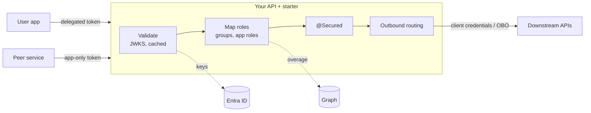

# spring-security-jwt-starter

[](https://github.com/rmkr-dev/spring-security-jwt-starter/actions/workflows/ci.yml)
[](LICENSE)

A Spring Boot 3 security starter (Java 17 and 21, MVC and WebFlux) for **Microsoft Entra ID**. It validates user
and service tokens, maps groups and app roles to `@Secured` roles, and calls downstream APIs as the service or on
behalf of the user.



## 5-minute quickstart

```xml
<dependency>
    <groupId>io.github.rmkr-dev</groupId>
    <artifactId>entra-security-spring-boot-starter</artifactId>
    <version>0.7.0</version>
</dependency>
```

```yaml
entra:
  security:
    tenant-id: 00000000-0000-0000-0000-000000000000   # Directory (tenant) ID
    client-id: 11111111-1111-1111-1111-111111111111   # this API's Application (client) ID
    group-role-mappings:
      "aaaaaaaa-aaaa-aaaa-aaaa-aaaaaaaaaaaa": [ORDERS_READ]
```

```java
@GetMapping("/api/orders")
@Secured("ROLE_ORDERS_READ")
List<Order> orders(EntraPrincipal caller) { ... }
```

Every path except health and info now needs a valid Entra token. Missing tokens get a `401` and missing roles a
`403`, both as `application/problem+json`. The full walkthrough is in [docs/quickstart.md](docs/quickstart.md).

## Documentation

- [Architecture](docs/architecture.md) · [Quickstart](docs/quickstart.md) · [User flow](docs/user-flow.md)
- [Service-to-service](docs/service-to-service.md) · [On-behalf-of](docs/on-behalf-of.md) · [Validation modes](docs/validation-modes.md)
- [Configuration reference](docs/configuration.md) · [Onboarding in Entra](docs/onboarding.md) · [Deployment on AKS](docs/deployment.md)
- [Observability and auth timing](docs/observability.md) · [Role patterns](docs/role-patterns.md) · [Performance](docs/performance.md)
- [CAE](docs/cae.md) · [Testing](docs/testing.md) · [Troubleshooting](docs/troubleshooting.md) · [Releases](docs/releasing.md)

## Building

```bash
mvn -B verify
```

No Entra tenant is needed: tests use local RSA keys, WireMock and the in-process mock authority. The build enforces
JaCoCo coverage minimums. See [CONTRIBUTING.md](CONTRIBUTING.md), [SECURITY.md](SECURITY.md) and
[CHANGELOG.md](CHANGELOG.md).

## License

[MIT](LICENSE)
