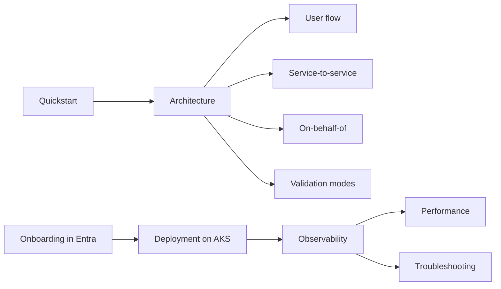

# Documentation

| Doc | What's in it |
| --- | --- |
| [architecture.md](architecture.md) | Overview, modules, security defaults, servlet vs WebFlux, customising, `EntraPrincipal` |
| [quickstart.md](quickstart.md) | Secure an API in five minutes |
| [user-flow.md](user-flow.md) | Delegated tokens, groups, app roles, scopes, group overage |
| [service-to-service.md](service-to-service.md) | App-only tokens in, outbound routing to external HTTPS and `*.svc.cluster.local` |
| [on-behalf-of.md](on-behalf-of.md) | Calling downstream APIs as the user |
| [validation-modes.md](validation-modes.md) | `jwks`, `introspection`, `hybrid`, and why JWKS is the right choice for Entra |
| [configuration.md](configuration.md) | Every `entra.security.*` property in one table, env vars, compact mappings |
| [onboarding.md](onboarding.md) | App registration, enterprise app, app roles, groups claim, consent, workload identity |
| [deployment.md](deployment.md) | AKS ConfigMap and Secret, credentials, Key Vault, health, Datadog |
| [observability.md](observability.md) | `Server-Timing`, `entra.security.auth.duration`, audit fields, meters, opt-in Prometheus/Grafana |
| [role-patterns.md](role-patterns.md) | `@Secured` first, and the opt-in role-pattern allow |
| [performance.md](performance.md) | Caches, budgets and measured numbers |
| [cae.md](cae.md) | Thin Continuous Access Evaluation support |
| [testing.md](testing.md) | Mock authority, test tokens, `@WithMockEntraUser` |
| [troubleshooting.md](troubleshooting.md) | 401/403 reasons, self-check messages, outbound and health problems |
| [releasing.md](releasing.md) | Installing from GitHub Packages, release files and SBOM, cutting a release |
| [compatibility.md](compatibility.md) | Supported Java and Spring Boot versions and how each is tested |
| [upgrading.md](upgrading.md) | Moving a service from 0.7.x (Boot 3) to 1.0 (Boot 4.1), and the Spring Boot version check |

Every page has its diagram inline as Mermaid. Rendered SVG and PNG copies are in [diagrams/](diagrams/), named
`<page>-<n>`. To regenerate them, run `scripts/render-diagrams.sh` (it needs Node and uses
`npx @mermaid-js/mermaid-cli`; nothing is added to the Maven build).
