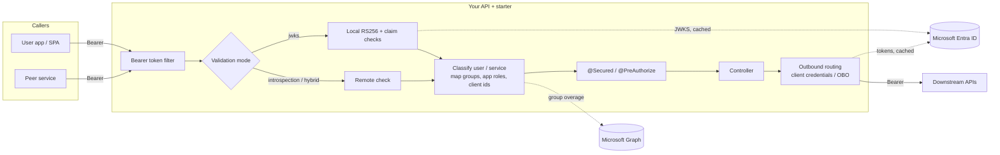

# Architecture

The starter turns a Spring Boot 4.1 service (Java 17, 21 or 25, Spring MVC or WebFlux) into a Microsoft Entra ID
resource server. It validates inbound tokens, maps them to `ROLE_*` authorities, and attaches the right token to
outbound calls, either as the service or on behalf of the user. Three optional flags
(`validation.reject-id-tokens`, `cache.bounded`, `multi-tenant.enabled`) stay off unless you set them. See
[configuration.md](configuration.md).



## Modules

| Module | Purpose |
| --- | --- |
| `entra-security-core` | JWT decoder and validators, introspection, user/service classification, authority mapping, Graph group lookup, token acquisition (secret, certificate, workload identity, Key Vault) for client credentials and on-behalf-of, outbound routing, auth timing and audit, Jackson 3 problem-details handlers, `EntraPrincipal`. |
| `entra-security-spring-boot-starter` | Auto-configuration, `entra.security.*` properties with validation, the default `SecurityFilterChain` (servlet) or `SecurityWebFilterChain` (WebFlux), `@EnableEntraSecurity`, `EntraOutboundClients`, optional health, metrics and monitoring. |
| `entra-security-test` | In-process mock Entra authority, signed test tokens, `@AutoConfigureEntraMockAuthority`, `@WithMockEntraUser`, `@WithMockEntraService`. See [testing.md](testing.md). |
| `sample-api`, `sample-reactive-api` | Example services on MVC and WebFlux, with Kubernetes manifests in `sample-api/k8s`. |

## Security defaults

- Stateless sessions, CSRF off, and no form login, HTTP Basic, logout or request cache.
- CORS follows your `CorsConfigurationSource` bean (or Spring MVC CORS config). Nothing is allowed cross-origin by default.
- RS256 signatures only, with keys from the tenant JWKS. `none`, HS* and unknown keys are rejected.
- The issuer must match exactly (v1 and v2). Audience and tenant (`tid`) are checked, `exp` is required, and `exp`/`nbf` allow a configurable clock skew.
- Every path except `public-paths` (health and info by default) needs a valid token.
- 401 and 403 responses are `application/problem+json` with a `WWW-Authenticate: Bearer` header. The body is
  written with the application's Jackson 3 `JsonMapper`. Spring Security 7's `resource_metadata` parameter is
  omitted, because this API does not publish a protected-resource metadata document.
- Tokens, names, UPNs and e-mail addresses are never logged.

## Servlet and WebFlux

The starter detects a reactive application and configures the WebFlux equivalents. Properties, mappings and
`@EnableEntraSecurity` stay the same.

| | Servlet | WebFlux |
| --- | --- | --- |
| Filter chain | `SecurityFilterChain` | `SecurityWebFilterChain` |
| Decoder | `JwtDecoder` | `ReactiveJwtDecoder` (the same validators and JWKS cache) |
| Role mapping | `EntraJwtAuthenticationConverter` | `ReactiveEntraJwtAuthenticationConverter` |
| Group overage | `GroupMembershipResolver` (`RestClient`) | `ReactiveGroupMembershipResolver` (`WebClient`, on `boundedElastic`) |
| Method security | `@Secured`, `@PreAuthorize`, `@RolesAllowed` | `@Secured`, `@PreAuthorize`, `@RolesAllowed` (methods returning `Mono`/`Flux`) |
| Health | `entraJwks`, `entraGraph` | same names, reactive indicators |
| Caller | `EntraPrincipal`, `EntraPrincipals.current()` | `EntraPrincipal` / `Mono<EntraPrincipal>`, `ReactiveEntraPrincipals.current()` |
| Own chain | `EntraHttpSecurity` | `EntraServerHttpSecurity` |

## Customising

Define your own chain and the default backs off. Reuse the Entra setup, including auth timing and audit:

```java
@Bean
SecurityFilterChain api(HttpSecurity http, EntraHttpSecurity entra) throws Exception {
    http.securityMatcher("/api/**");
    return entra.configure(http).build();
}
```

All the main beans (`JwtDecoder`, `EntraAuthorityMapper`, `GroupMembershipResolver`, `TokenIntrospector`,
the converters and the problem-details handlers, plus their reactive variants) are `@ConditionalOnMissingBean`.

## The caller: `EntraPrincipal`

| Field | Meaning |
| --- | --- |
| `type` | `USER` or `SERVICE` |
| `objectId` | `oid` of the user or service principal (`getName()`) |
| `appId` | calling client: `azp` (v2) or `appid` (v1) |
| `tenantId`, `subject`, `tokenVersion` | `tid`, `sub`, `ver` |
| `roles` | granted authorities, such as `ROLE_ORDERS_READ` |
| `appRoles`, `groups`, `scopes` | raw `roles`, groups (from the token or Graph), `scp` |
| `displayName`, `username` | `name`, `preferred_username`/`upn` (users) |

Helpers: `isUser()`, `isService()`, `hasRole("X")`, `hasAppRole("X")`, `isMemberOf(groupId)`.
