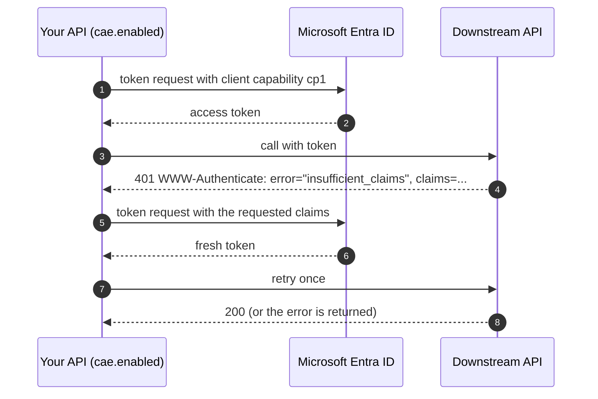

# Continuous Access Evaluation (thin)

Off by default. Turn it on with `entra.security.cae.enabled=true`.

What it does:

- **Outbound:** token requests declare the `cp1` client capability. If a downstream API answers 401 with
  `error="insufficient_claims"`, the client fetches a fresh token with the requested claims and retries once.
- **Inbound:** throwing `ClaimsChallengeException` produces a 401 with a `WWW-Authenticate` claims challenge,
  but only when the caller's token carries `xms_cc=cp1`. Other callers get a plain 403.

What it doesn't do: it never ends a session or revokes anything on its own. The calling client decides what to do
with a challenge.
