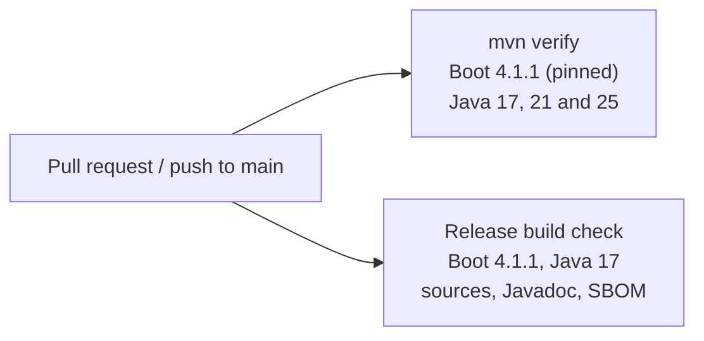
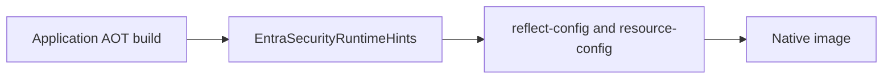

# Compatibility

The starter is built on Spring Boot 4.1. The version pinned in the root `pom.xml` is what CI compiles and tests.



## Tested versions

The build runs unit tests, the MVC and WebFlux sample applications, and the coverage gate.

| Spring Boot | Tested patch | Spring Framework | Spring Security | Jackson | Java |
| --- | --- | --- | --- | --- | --- |
| 4.1.x | 4.1.1 | 7.0 | 7.1 | 3.1 (tools.jackson) | 17, 21, 25 |

Your Spring Boot parent (or an imported `spring-boot-dependencies` BOM) decides the Spring, Security, Micrometer
and Jackson versions at runtime. Import that BOM rather than pinning those libraries by hand.

Problem responses (`application/problem+json`) are written with the application's Jackson 3 `JsonMapper`. When
the application has not defined one, the starter builds a `JsonMapper` itself.

## Starters to use

Spring Boot 4 renamed the web and resource-server starters. Use the new names:

| This service | Dependency |
| --- | --- |
| Spring MVC | `spring-boot-starter-webmvc` |
| WebFlux | `spring-boot-starter-webflux` |
| `RestClient.Builder` | `spring-boot-starter-restclient` |
| `WebClient.Builder` | `spring-boot-starter-webclient` |
| Actuator | `spring-boot-starter-actuator` |
| `@WithMockEntraUser` in MockMvc or WebTestClient | `spring-boot-starter-security-test` (test scope) |

`spring-boot-starter-web` and `spring-boot-starter-oauth2-resource-server` still exist and are deprecated.
New services should use the names in the table. The starter itself depends on
`spring-boot-starter-security-oauth2-resource-server`.

## Not supported on this line

- **Spring Boot 3.x.** 3.5.16 was the last 3.5 patch, and open-source support for 3.5 ended on 30 June 2026.
  Spring asks library authors not to support Boot 3 and Boot 4 from one artifact. Stay on entra-security
  `0.7.x` for a Boot 3.5 service.
- **Spring Boot 4.0.** 4.1 moved the OAuth2 resource-server auto-configuration again
  (`org.springframework.boot.security.oauth2.server.resource.autoconfigure`). This line is compiled against 4.1.1.
- **Spring Boot 4.2.** Not generally available yet. The pin moves when a 4.1 patch or the next GA line is adopted.

## Native image

Auto-configuration registers `EntraSecurityRuntimeHints`: the `AutoConfiguration.imports` file, the
configuration metadata, Nimbus JOSE service files, and reflection for the auto-configuration classes, the
health indicators, `JsonMapper`, and the Nimbus RSA types the decoder constructs. A consuming application
picks the hints up when it runs Spring Boot AOT (`process-aot` or a native build).



## Building against the pinned line

`spring-boot.version` drives the Boot BOM and the Boot Maven plugin:

```bash
mvn -B verify
```

When a new 4.1 patch ships, update `spring-boot.version` in the root `pom.xml` and the table above.
Dependabot opens minor and patch updates for Spring Boot. A move to Boot 5 stays a separate change.
