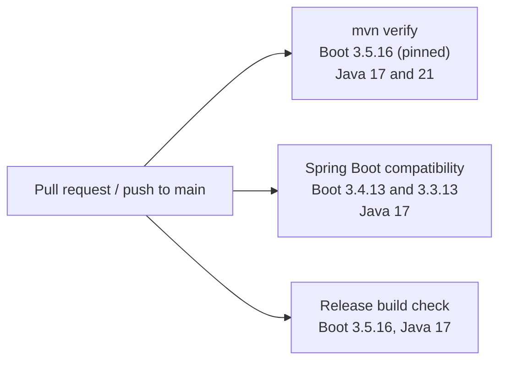

# Compatibility

The starter is built on the Spring Boot version pinned in the root `pom.xml` and is tested in CI against the
latest patch of each older supported 3.x line.



## Tested versions

Every line runs the full build: unit tests, the MVC and WebFlux sample applications, and the coverage gate.

| Spring Boot | Tested patch | Spring Framework | Spring Security | Micrometer | Java |
| --- | --- | --- | --- | --- | --- |
| 3.5.x | 3.5.16 | 6.2 | 6.5 | 1.15 | 17, 21 |
| 3.4.x | 3.4.13 | 6.2 | 6.4 | 1.14 | 17 |
| 3.3.x | 3.3.13 | 6.1 | 6.3 | 1.13 | 17 |

Your Spring Boot parent (or an imported `spring-boot-dependencies` BOM) decides the Spring, Micrometer and
Jackson versions at runtime, so use one of them rather than pinning those libraries by hand.

## Not supported

- **Spring Boot 3.2 and older.** The starter uses Spring Security 6.3 APIs (`AuthorizationAdvisor`, for the
  role-pattern allow) and the Prometheus 1.x client that came with Micrometer 1.13 (`io.micrometer.prometheusmetrics`).
  Neither exists on Boot 3.2, and open-source support for 3.2 has ended.
- **Spring Boot 4.x.** The starter targets Spring Boot 3.

## Building against another line

`spring-boot.version` drives the Boot BOM and the Boot Maven plugin, so one property switches the whole build:

```bash
mvn -B verify -Dspring-boot.version=3.4.13
```

When a new Boot patch ships, update the versions in the `boot-compat` job in `.github/workflows/ci.yml` and in
the table above. Dependabot keeps the pinned version current.
