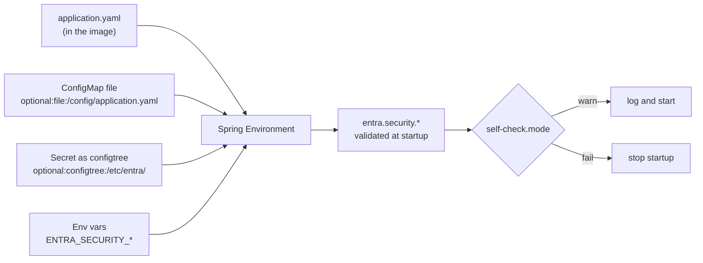
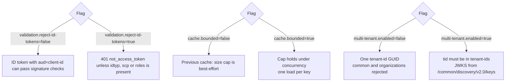

# Configuration reference

Every property lives under `entra.security`. Invalid configuration stops startup with a message that names the
property, and the [startup self-check](troubleshooting.md#startup-self-check) catches the usual mistakes.



Sources later in Spring's order win. Env vars beat the ConfigMap file, which beats the packaged `application.yaml`.

## Optional flags

Three behaviors are off until you set one flag each. All three use the `entra.security` prefix. Leaving them
unset keeps a single-tenant API, the previous cache, and the previous token acceptance rules.



```yaml
entra:
  security:
    validation:
      reject-id-tokens: true          # default false
    cache:
      bounded: true                    # default false
    multi-tenant:
      enabled: false                   # default; leave this for a single-tenant API
      tenant-ids: []
```

| Flag | Default | What changes when you turn it on |
| --- | --- | --- |
| `validation.reject-id-tokens` | `false` | A token must carry `idtyp`, a non-empty `scp`, or a non-empty `roles`. An ID token, whose `aud` is often the raw client id (also a default audience), is rejected with audit reason `not_access_token`. A real access token whose `aud` is the client id still passes. |
| `cache.bounded` | `false` | Every Entra cache (validated tokens, role mapping, introspection, Graph membership) stays within its max entries when many threads insert at once, and one load runs per key. Reactive Graph lookups share one `Mono` instead of blocking. Failures are still not cached. |
| `multi-tenant.enabled` | `false` | Inbound `tid` must be a GUID in `multi-tenant.tenant-ids`. A GUID `tenant-id` is included in that list. Issuers are the v1 and v2 issuers of each accepted directory unless you set `issuers` yourself. The JWKS URI becomes `{authority-host}/common/discovery/v2.0/keys` unless you set `jwk-set-uri` or `authority.jwks-uri`. `tenant-id` may be `organizations` or `common`. `consumers` stays rejected. Outbound client-credentials still use a real directory: set `tenant-id` to a GUID, or set `credential.tenant-id`. |

With `multi-tenant.enabled=false`, `tenant-id` must be one directory GUID. `common`, `organizations` and
`consumers` stop startup.

## All properties

| Property | Default | Description |
| --- | --- | --- |
| **Core** | | |
| `enabled` | `true` | Whether the starter is active. |
| `multi-tenant.enabled` | `false` | When true, accept tokens whose `tid` is in `multi-tenant.tenant-ids` (plus a GUID `tenant-id`). Off by default: one directory only. |
| `multi-tenant.tenant-ids` | - | Directory GUIDs allowed when `multi-tenant.enabled` is true. Ignored while the flag is off. |
| `tenant-id` | **required** | Directory (tenant) ID of your Microsoft Entra tenant (a GUID). |
| `client-id` | **required** | Application (client) ID of this API's app registration. |
| `audiences` | - | Accepted token audiences. Defaults to api://{client-id} and {client-id}. |
| `require-tenant-match` | `true` | Whether `tid` must equal `tenant-id`. When `multi-tenant.enabled` is true, `tid` must be in the allow-list instead. |
| `clock-skew` | `60s` | Tolerated clock skew when checking exp and nbf. |
| `public-paths` | `/actuator/health`, `/actuator/health/**`, `/actuator/info` | Ant-style paths that are reachable without a token. |
| **Authority and endpoints** | | |
| `authority-host` | `https://login.microsoftonline.com` | Entra authority host. Change it for sovereign clouds, for example https://login.microsoftonline.us. `entra.security.authority.host` takes precedence when set. |
| `authority.allow-http` | `false` | Allow plain http endpoints on hosts other than localhost, for example an in-cluster IdP at http://idp.auth.svc.cluster.local. Keep it off in production unless the hop is otherwise protected. |
| `authority.authorize-endpoint` | - | Authorize endpoint. Not called by the starter; exposed through EntraEndpoints for applications. |
| `authority.discovery.enabled` | `false` | Fetch the OIDC metadata document at startup and use it for every endpoint that is not configured. |
| `authority.discovery.required` | `true` | Fail startup when the metadata document cannot be fetched or is invalid. When false, a warning is logged and the defaults are used. |
| `authority.graph-base-url` | - | Microsoft Graph base URL. Overrides entra.security.graph.base-url, for example https://graph.microsoft.us. |
| `authority.host` | - | Authority host, for example https://login.microsoftonline.us (US Government), https://login.chinacloudapi.cn, https://contoso.b2clogin.com, https://contoso.ciamlogin.com or a custom domain. Overrides entra.security.authority-host. |
| `authority.issuers` | - | Accepted issuers. Overrides entra.security.issuers and the discovered issuer. |
| `authority.jwks-uri` | - | JWKS endpoint. Overrides entra.security.jwk-set-uri and the discovered jwks_uri. |
| `authority.metadata-uri` | - | OIDC discovery (metadata) document. Defaults to {host}/{tenant-path}/v2.0/.well-known/openid-configuration. Setting it turns discovery on. |
| `authority.tenant-path` | - | Path after the host that endpoints are built from. Defaults to the tenant id. For B2C use {tenant}.onmicrosoft.com/{policy}, for example contoso.onmicrosoft.com/B2C_1_signin. |
| `authority.token-endpoint` | - | Token endpoint used for client-credentials, on-behalf-of and Graph tokens of this API's tenant. |
| `authority.userinfo-endpoint` | - | Userinfo endpoint. Defaults to the discovered userinfo_endpoint, or {graph-base-url}/oidc/userinfo. |
| `issuers` | - | Accepted token issuers. Defaults to the tenant's v1 (sts.windows.net) and v2 issuers. `entra.security.authority.issuers` takes precedence when set. |
| `jwk-set-uri` | - | JWKS endpoint. Defaults to {authority-host}/{tenant-id}/discovery/v2.0/keys. `entra.security.authority.jwks-uri` takes precedence when set. |
| **Validation** | | |
| `validation.hybrid-strategy` | `both` | For hybrid: both (default) or fallback. |
| `validation.introspection.auth-method` | `client-secret-basic` | Client authentication for rfc7662. |
| `validation.introspection.cache-max-entries` | `10000` | Maximum number of cached results. |
| `validation.introspection.claims-mapping` | - | Extra claim mappings, target claim to response field, for example oid: user_id or roles: groups. |
| `validation.introspection.client-id` | - | Client id for client-secret-basic/post. Defaults to entra.security.client-id. |
| `validation.introspection.client-secret` | - | Client secret for client-secret-basic/post. Defaults to entra.security.credential.client-secret. |
| `validation.introspection.connect-timeout` | `2s` | Connect timeout of the remote check. |
| `validation.introspection.failure-threshold` | `5` | Consecutive failures that open the circuit breaker. |
| `validation.introspection.negative-cache-ttl` | `10s` | Inactive results are cached this long. |
| `validation.introspection.open-duration` | `30s` | How long the circuit stays open (tokens that are not cached are rejected) before one trial call. |
| `validation.introspection.positive-cache-ttl` | `5m` | Active results are cached until the token expires or this passes, whichever is first. |
| `validation.introspection.read-timeout` | `3s` | Read timeout of the remote check. |
| `validation.introspection.scope` | - | Scope of the app-only token for auth-method bearer, for example api://gateway/.default. |
| `validation.introspection.token-type-hint` | `access_token` | token_type_hint sent with rfc7662 requests. Empty to omit it. |
| `validation.introspection.type` | `rfc7662` | rfc7662 (default) or userinfo. |
| `validation.introspection.uri` | - | Endpoint to call. Defaults to the discovered introspection_endpoint for rfc7662, and to the authority userinfo endpoint (Graph /oidc/userinfo by default) for userinfo. |
| `validation.introspection.validate-claims` | `true` | Check exp/nbf, iss, aud and tid of the introspected claims with the same rules as JWKS validation. Applies to rfc7662; userinfo checks only the timestamps, since those tokens are for Graph. |
| `validation.mode` | `jwks` | jwks (default), introspection or hybrid. |
| `validation.reject-id-tokens` | `false` | When true, reject tokens that have none of `idtyp`, `scp` or `roles`. Audit reason `not_access_token`. Off by default. |
| **Role mapping** | | |
| `group-role-mappings` | - | Group object id (or group name, when the groups claim emits names) to roles. |
| `app-role-mappings` | - | App role value (the roles claim) to roles. Unmapped app roles become ROLE_{value} unless disabled. |
| `client-role-mappings` | - | Calling client id (azp/appid) to roles. Also the allow-list when service.require-known-client is true. |
| `group-role-mappings-compact` | - | Group mappings on one line, merged with group-role-mappings: `<group>=<ROLE>[\|<ROLE>...]` entries separated by ';' or ','. Suits environment variables (ENTRA_SECURITY_GROUPROLEMAPPINGSCOMPACT) and ConfigMap scalars. |
| `app-role-mappings-compact` | - | App role mappings on one line, merged with app-role-mappings: `<app-role>=<ROLE>[\|<ROLE>...];...`. |
| `client-role-mappings-compact` | - | Client mappings on one line, merged with client-role-mappings: `<client-id>=<ROLE>[\|<ROLE>...];...`. Client ids must be GUIDs. |
| `user.include-roles-claim` | `true` | Whether the roles claim of user tokens (app roles assigned through the enterprise app) is mapped. |
| `user.include-scopes` | `false` | Whether scp values are granted as SCOPE_{scope} authorities. |
| `user.default-roles` | - | Roles granted to every authenticated user. |
| `service.map-unmapped-app-roles` | `true` | Whether app roles without an app-role-mappings entry become ROLE_{value}. |
| `service.require-known-client` | `false` | Reject app-only tokens whose azp/appid is not a key of client-role-mappings. |
| `service.default-roles` | - | Roles granted to every authenticated service. |
| **Authorization** | | |
| `authorization.allow-role-patterns` | - | Roles that open every authenticated API. Globs (`*hardware*`) or Java regular expressions prefixed with `regex:`, matched against the whole mapped role name with or without `ROLE_`. A caller with any matching role passes `@Secured`, `@PreAuthorize`, `@PostAuthorize` and `@RolesAllowed`. Empty (off) by default; prefer explicit `@Secured` rules. |
| `authorization.allow-role-patterns-case-sensitive` | `false` | Match `allow-role-patterns` case-sensitively. |
| `method-security.enabled` | `true` | Enable @Secured, @PreAuthorize and @RolesAllowed without @EnableMethodSecurity. |
| **Microsoft Graph** | | |
| `graph.base-url` | `https://graph.microsoft.com` | Microsoft Graph base URL. |
| `graph.cache-max-entries` | `10000` | Maximum number of users whose memberships are cached. |
| `graph.cache-ttl` | `10m` | How long resolved memberships are cached per user. |
| `graph.max-pages` | `20` | Maximum number of Graph result pages followed per lookup. |
| `graph.overage-enabled` | `false` | Resolve groups through Microsoft Graph when the token signals group overage. |
| `graph.scope` | `https://graph.microsoft.com/.default` | Scope requested for Graph tokens. |
| **Credential** | | |
| `credential.certificate-password` | - | For type certificate: the PKCS#12 keystore password, or the password of an encrypted PEM private key (ENCRYPTED PRIVATE KEY). Supply it from a Kubernetes Secret. |
| `credential.certificate-path` | - | PEM (certificate + PKCS#8 key) or PKCS#12 (.p12/.pfx) file, for type certificate. |
| `credential.client-id` | - | Client id requesting tokens. Defaults to entra.security.client-id (or AZURE_CLIENT_ID for workload identity). |
| `credential.client-secret` | - | Client secret, for type client-secret. Supply it from a Kubernetes Secret. |
| `credential.federated-token-file` | - | Federated token file, for type workload-identity. Defaults to AZURE_FEDERATED_TOKEN_FILE. |
| `credential.key-vault.certificate-name` | - | Name of the Key Vault certificate. Its private key must be exportable (the default). |
| `credential.key-vault.certificate-version` | - | Certificate version. Defaults to the latest version, so rotations are picked up on refresh. |
| `credential.key-vault.identity-client-id` | - | Client id of the user-assigned managed identity or workload identity used to read the vault. Defaults to AZURE_CLIENT_ID (set by the AKS workload identity webhook) or the system-assigned identity. |
| `credential.key-vault.refresh-interval` | `1h` | How often the certificate is reloaded from Key Vault. |
| `credential.key-vault.retry-interval` | `1m` | How long to wait before retrying after a failed reload. The cached certificate is used meanwhile. |
| `credential.key-vault.vault-url` | - | Vault URL, for example https://my-vault.vault.azure.net. |
| `credential.tenant-id` | - | Tenant to request tokens from. Defaults to entra.security.tenant-id (or AZURE_TENANT_ID for workload identity). |
| `credential.type` | `none` | Credential type: none, client-secret, certificate, workload-identity or key-vault-certificate. |
| **Outbound** | | |
| `outbound.clients` | - | Named outbound clients, for example orders-api. |
| `outbound.customize-builders` | `true` | Whether the routes are added to every RestClient.Builder and WebClient.Builder that Spring Boot provides. Turn this off to apply them yourself with EntraOutboundClients#routingInterceptor(). |
| `outbound.routes` | - | Routes that pick the outbound client (and optionally the scope) per request, by URL pattern or host, so one RestClient or WebClient can call several peers. The first matching route wins; requests that match no route are sent without a token. |
| `outbound.skip-hosts` | - | Hosts that never get a token from the routes, even when a route matches, for example public.shop.svc.cluster.local or *.blob.core.windows.net. An optional :port restricts the port. |
| `outbound.clients.<name>.flow` | `client-credentials` | `client-credentials` (app-only) or `on-behalf-of` (as the calling user). |
| `outbound.clients.<name>.scope` | **required** | Scope for the peer, e.g. `api://<peer>/.default`, or delegated scopes for `on-behalf-of`. |
| `outbound.clients.<name>.base-url` | - | Peer base URL, returned by `EntraOutboundClients#baseUrl`. |
| `outbound.clients.<name>.credential.*` | `entra.security.credential` | Per-client credential override. |
| `outbound.routes[n].name` | - | Optional route name. |
| `outbound.routes[n].urls` | - | URL patterns such as `https://example.text.com/api/**`. |
| `outbound.routes[n].hosts / paths` | - | Host patterns (`*.domain`, optional `:port`) and Ant-style paths. |
| `outbound.routes[n].client` | **required** | Outbound client used for matching requests. |
| `outbound.routes[n].scope` | client scope | Scope for this route only. |
| `outbound.routes[n].allow-http` | in-cluster and loopback only | Whether `hosts` match over plain http. |
| **Caching and HTTP** | | |
| `cache.authentication-max-entries` | `10000` | Maximum number of remembered role mappings. |
| `cache.bounded` | `false` | When true, every Entra cache stays within its max entries under concurrency and one load runs per key. Off by default. |
| `cache.authentication-ttl` | `5m` | How long the principal and role mapping of a token are remembered (including the Graph overage result). Never past the token's `exp`. Zero disables the cache. |
| `cache.jwks-prewarm` | `true` | Load the JWKS while the application starts, so the first request never waits for it. |
| `cache.jwks-refresh-ahead` | `5m` | Refresh the JWKS on a background thread during this window before `jwks-ttl` ends; zero refreshes on the request that finds the keys expired. Capped at half of `jwks-ttl`. |
| `cache.jwks-ttl` | `15m` | How long the JWKS is cached before it is refreshed. |
| `cache.on-behalf-of-max-entries` | `10000` | Maximum number of on-behalf-of tokens cached per outbound client (one per user and scope). |
| `cache.token-background-refresh` | `true` | Renew outbound and Graph app tokens on a background thread once they enter the `token-refresh-skew` window, instead of on the request that finds them stale. |
| `cache.token-refresh-skew` | `5m` | How long before expiry an acquired outbound/Graph token is renewed. |
| `cache.validated-token-max-entries` | `10000` | Maximum number of remembered validated tokens. |
| `cache.validated-token-ttl` | `5m` | How long a successfully validated token is remembered, so presenting it again skips the signature and claim checks. Never past the token's `exp`. Zero disables the cache. Used in jwks mode only. |
| `http.connect-timeout` | `2s` | Connect timeout. |
| `http.read-timeout` | `3s` | Read timeout. |
| **Observability, audit and monitoring** | | |
| `audit.enabled` | `true` | Write one log line per auth decision to the `entra.security.audit` logger at INFO. |
| `audit.format` | `json` | `json` (one JSON object per line) or `flat` (one `key=value` line). |
| `logging.log-claims` | `false` | Log a privacy-safe claim summary of each accepted token at DEBUG. |
| `monitoring.datadog.percentiles` | `true` | Publish client-side p50/p95/p99 for entra.security timers (Datadog cannot aggregate histograms). |
| `monitoring.prometheus.enabled` | `false` | Export entra.security meters to Prometheus. Off by default: when false, the meters are filtered out of a Prometheus registry even if one is present. |
| `monitoring.tags` | - | Extra tags added to every `entra.security.*` meter, e.g. `service=orders-api`. |
| `observability.server-timing` | `true` | Add `Server-Timing: auth;dur=<ms>` to every authenticated response. The authentication time is always recorded as the `entra.security.auth.duration` timer; this switch only controls the header. |
| **Startup and CAE** | | |
| `self-check.mode` | `warn` | `warn` logs each problem, `fail` stops startup, `off` skips the check. Checks GUID formats, that an audience is set, that the JWKS or introspection endpoint answers, and that outbound clients have a credential. |
| `cae.enabled` | `false` | Declare the `cp1` client capability on outbound token requests, answer a downstream `insufficient_claims` challenge once with a fresh token, and render `ClaimsChallengeException` as a claims challenge for callers whose token has `xms_cc=cp1`. The library never ends a session on its own. |

## Environment variables and compact mappings

Scalars bind from env vars with Spring's relaxed binding: `ENTRA_SECURITY_TENANTID`, `ENTRA_SECURITY_CLOCKSKEW=90s`,
`ENTRA_SECURITY_VALIDATION_MODE=jwks`, `ENTRA_SECURITY_CREDENTIAL_CLIENTSECRET` (from `secretKeyRef`).

Map keys such as group GUIDs can't be env var names, so use the compact form:

```bash
ENTRA_SECURITY_GROUPROLEMAPPINGSCOMPACT="aaaaaaaa-aaaa-aaaa-aaaa-aaaaaaaaaaaa=ORDERS_READ;bbbbbbbb-bbbb-bbbb-bbbb-bbbbbbbbbbbb=ORDERS_READ|ORDERS_WRITE"
ENTRA_SECURITY_APPROLEMAPPINGSCOMPACT="Orders.Sync=ORDERS_SYNC"
ENTRA_SECURITY_CLIENTROLEMAPPINGSCOMPACT="cccccccc-cccc-cccc-cccc-cccccccccccc=ORDERS_SYNC"
```

- Entries are `key=ROLE`, separated by `;` or `,`. Whitespace, newlines and a trailing separator are ignored.
- Give a key several roles with `|`, or repeat the key. The `ROLE_` prefix is optional.
- The compact and map forms are merged, and keys are compared case-insensitively.
- A malformed value stops startup with the property, the entry and the problem. Keys containing `=`, `;`, `,` or
  `|` need the map form.

`SPRING_APPLICATION_JSON` also works for the map form. In YAML, wrap keys that contain characters other than
letters, digits and `-` in brackets: `"[Orders.Sync]"`, `"[Order Admins]"`.
