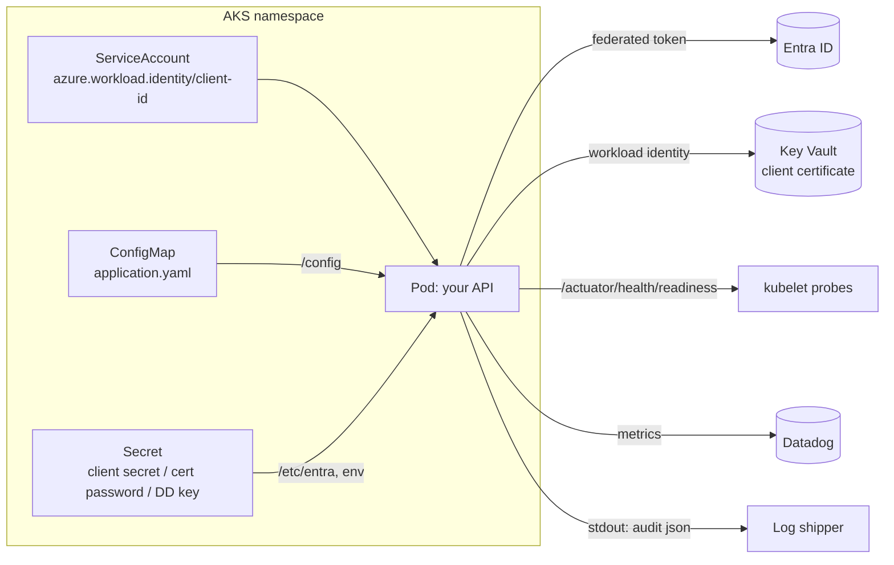

# Deployment (AKS)



## ConfigMap and Secret

Non-secret settings go in a ConfigMap mounted as a file. Secrets go in a Secret mounted as a configtree, where each
key is a file named after the property.

```yaml
apiVersion: v1
kind: ConfigMap
metadata: { name: orders-api-entra }
data:
  application.yaml: |
    entra:
      security:
        tenant-id: "00000000-0000-0000-0000-000000000000"
        client-id: "11111111-1111-1111-1111-111111111111"
        group-role-mappings:
          "aaaaaaaa-aaaa-aaaa-aaaa-aaaaaaaaaaaa": [ORDERS_READ]
        app-role-mappings:
          "[Orders.Sync]": [ORDERS_SYNC]
        graph: { overage-enabled: true }
        credential: { type: workload-identity }
        self-check: { mode: fail }
---
apiVersion: v1
kind: Secret
metadata: { name: orders-api-entra }
type: Opaque
stringData:
  entra.security.credential.client-secret: "<only when credential.type=client-secret>"
```

```yaml
# application.yaml in the image
spring:
  config:
    import:
      - optional:file:/config/application.yaml
      - optional:configtree:/etc/entra/
```

Full manifests: [`sample-api/k8s`](../sample-api/k8s).

## Credentials

| `credential.type` | Settings | Notes |
| --- | --- | --- |
| `workload-identity` | `federated-token-file` (optional) | Recommended on AKS. Uses the webhook's `AZURE_FEDERATED_TOKEN_FILE`, `AZURE_CLIENT_ID`, `AZURE_TENANT_ID` and `AZURE_AUTHORITY_HOST`. The file is re-read on each token request. |
| `certificate` | `certificate-path`, `certificate-password` | PEM (cert + PKCS#8 key, which may be `ENCRYPTED PRIVATE KEY`) or `.p12`/`.pfx`. Sends an RS256 client assertion with `x5t`. |
| `key-vault-certificate` | `key-vault.vault-url`, `key-vault.certificate-name` | Certificate kept in Key Vault (below). |
| `client-secret` | `client-secret` | From a Secret. Fine for development. |

Workload identity: label the pod `azure.workload.identity/use: "true"` and annotate its ServiceAccount with
`azure.workload.identity/client-id: <client id>`. The federated credential is described in
[onboarding.md](onboarding.md#workload-identity-aks).

Encrypted PEM: `openssl pkcs8 -topk8 -v2 aes-256-cbc -v2prf hmacWithSHA256 -in key.pem -out key-enc.pem`, then
`cat cert.pem key-enc.pem > client.pem`. Legacy `Proc-Type: 4,ENCRYPTED` keys aren't supported. A wrong password
stops startup without printing it.

## Key Vault certificates

Add `com.azure:azure-identity` and `azure-security-keyvault-secrets` (or `-certificates`), managed by
`com.azure:azure-sdk-bom`. The starter is built against 1.3.9.

```yaml
entra:
  security:
    credential:
      type: key-vault-certificate
      key-vault:
        vault-url: https://orders-kv.vault.azure.net
        certificate-name: orders-api-client
        refresh-interval: 1h     # reload, so rotations are picked up
        retry-interval: 1m       # after a failed reload; the cached certificate stays in use
```

- The vault is read with `DefaultAzureCredential`: workload identity on AKS, managed identity elsewhere. To use a
  different identity, define a `TokenCredential` bean named `entraKeyVaultTokenCredential`.
- Grant *Key Vault Secrets User* (or *Key Vault Certificate User* with the certificates library). The key must be
  exportable, which is the default.
- Upload the new certificate's public part to the app registration **before** rotating it in Key Vault.
- If the Azure SDK is missing, startup fails and names the dependencies to add.

## Health

Add `spring-boot-starter-actuator`. Both indicators are part of the readiness group, not liveness, so an Entra
outage stops traffic without restarting pods.

| Component | Registered when | DOWN when |
| --- | --- | --- |
| `entraJwks` | Actuator present (not in `introspection` mode) | JWKS unreachable (`reason=unreachable`) or no RSA signing key (`no_signing_keys`) |
| `entraGraph` | `graph.overage-enabled=true` | token fails (`token`), Graph rejects the credential (`unauthorized`) or is unreachable (`unreachable`) |

```yaml
management:
  endpoint.health.probes.enabled: true
  endpoints.web.exposure.include: health,info
```

`/actuator/health/**` and `/actuator/info` are public by default. `/actuator/metrics` is not.

## Metrics with Datadog

Datadog is the documented backend. Add `io.micrometer:micrometer-registry-datadog` and keep the API key in a
Secret:

```yaml
management:
  datadog:
    metrics:
      export:
        api-key: ${DATADOG_API_KEY}
        step: 30s
        uri: https://api.datadoghq.eu     # your Datadog site
  metrics:
    tags: { env: prod }
entra:
  security:
    monitoring:
      tags: { service: orders-api }       # added to every entra.security.* meter
```

```yaml
env:
  - name: DATADOG_API_KEY
    valueFrom: { secretKeyRef: { name: datadog, key: api-key } }
```

The starter publishes client-side p50/p95/p99 for its timers, because Datadog can't aggregate Micrometer
histograms (`monitoring.datadog.percentiles=false` turns that off). Prometheus and Grafana are optional, see
[observability.md](observability.md#prometheus-and-grafana-opt-in).

## Logs

Audit lines go to stdout as `json` (default) or `flat`. Whatever ships your container logs ships them, and no
log-shipper-specific configuration is needed. See [observability.md](observability.md#audit-line).
