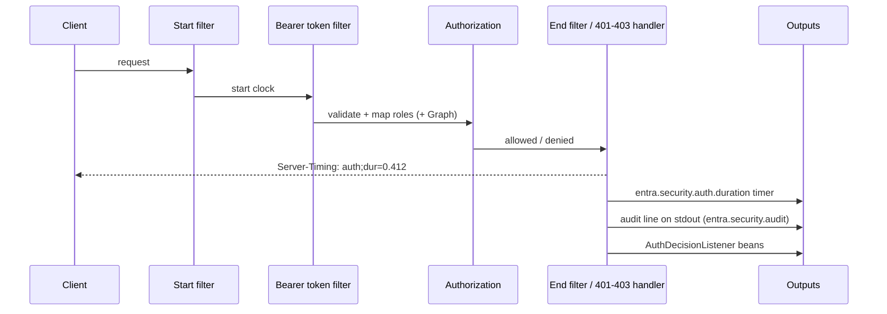

# Observability and auth timing

Every request that carries a bearer token, or is rejected for lacking one, has its authentication work timed: token
validation, role mapping, the Graph overage lookup and authorization. Each decision produces a
`Server-Timing` header, a timer sample and one audit line.



## Auth timing

| Output | Default | Switch |
|---|---|---|
| Micrometer timer `entra.security.auth.duration`, tags `outcome` (success, unauthenticated, forbidden, error), `token_type` (user, service, unknown, none), `validation_mode` (jwks, introspection, hybrid) | always on | - |
| `Server-Timing: auth;dur=<ms>` response header | on | `entra.security.observability.server-timing=false` |

Servlet and WebFlux behave the same. A method-security denial (`@Secured`) is recorded as `forbidden`. Public
paths called without a token are not recorded.

The timing hooks are part of `EntraHttpSecurity` / `EntraServerHttpSecurity`, so applications that build their own
filter chain with those helpers get them too.

## Audit line

One line per auth decision, written through SLF4J to the logger `entra.security.audit` at INFO, so it lands in
the normal application log / stdout. There is no Splunk- or Datadog-specific configuration: whatever ships your
logs ships these.

| Property | Default | Meaning |
|---|---|---|
| `entra.security.audit.enabled` | `true` | Turn the audit line off |
| `entra.security.audit.format` | `json` | `json` (one object per line) or `flat` (one `key=value` line) |

Fields: `ts`, `traceId` (MDC `traceId`/`correlationId`, else the W3C `traceparent` trace id, else
`X-Correlation-ID`/`X-Request-ID`, else generated), `outcome`, `reason`, `tokenType`, `validationMode`, `tid`,
`oid` (users) or `appid` (services), `roles`, `method`, `path` (no query string), `authMs`.

```json
{"ts":"2026-10-19T06:31:04.428Z","traceId":"4bf92f3577b34da6a3ce929d0e0e4736","outcome":"success","reason":"authorized","tokenType":"user","validationMode":"jwks","tid":"1111…","oid":"3333…","roles":["ROLE_ORDERS_READ"],"method":"GET","path":"/orders","authMs":1.932}
```

```text
ts=2026-10-19T06:31:04.433Z traceId=1039e7e0-… outcome=forbidden reason=access_denied tokenType=user validationMode=jwks tid=1111… oid=3333… roles=ROLE_ORDERS_READ method=GET path=/admin authMs=3.018
```

Tokens, names, UPNs and e-mail addresses are never logged. To silence or route the lines on their own, set
`logging.level.entra.security.audit=OFF` or give that logger its own appender.

## Meters

All meters use the `entra.security` prefix. Tags are a fixed set: no object id, token, tenant or group id is ever a
tag value. Add your own common tags with `entra.security.monitoring.tags.*`.

| Meter | Type | Tags |
| --- | --- | --- |
| `entra.security.auth.duration` | timer (percentile histogram) | `outcome`, `token_type`, `validation_mode` |
| `entra.security.jwt.authentications` | counter | `result` (`success`/`failure`), `reason` |
| `entra.security.jwks.refreshes` | timer | `result` |
| `entra.security.token.acquisitions` | timer | `result`, `credential` (`client_secret`, `certificate`, `workload_identity`), `grant` (`client_credentials`, `on_behalf_of`) |
| `entra.security.graph.lookups` | timer | `result` |
| `entra.security.introspection.requests` | timer | `result` (`active`, `inactive`, `error`, `rejected`) |

Failure reasons: `missing`, `expired`, `not_yet_valid`, `invalid_issuer`, `invalid_audience`, `invalid_tenant`,
`missing_claims`, `invalid_signature`, `unknown_key`, `malformed`, `client_not_allowed` and `invalid_token`.
JWKS refreshes, Graph lookups and token calls are recorded only when the starter actually makes the HTTP call, not
when it serves a cached result.

## Datadog

Datadog is the documented backend. Configuration (API key from a Secret, step, tags) is in
[deployment.md](deployment.md#metrics-with-datadog). With `micrometer-registry-datadog` on the classpath the
starter adds client-side p50/p95/p99 to the `entra.security` timers. Turn that off with
`entra.security.monitoring.datadog.percentiles=false`.

## Prometheus and Grafana (opt-in)

Prometheus is used only when `micrometer-registry-prometheus` is on the classpath **and**
`entra.security.monitoring.prometheus.enabled=true`. Otherwise the entra meters are filtered out of any Prometheus
registry. Expose `/actuator/prometheus` as usual and import the sample dashboard
[grafana/entra-security-dashboard.json](grafana/entra-security-dashboard.json): decisions per second by outcome,
auth p50/p95/p99, JWKS refreshes and outbound token acquisitions.
