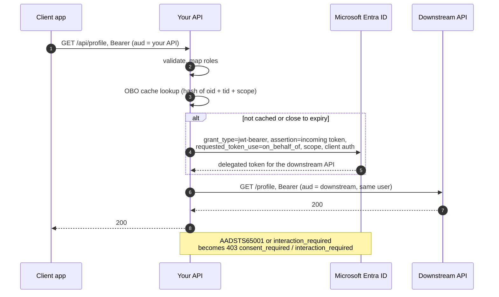

# Calling APIs as the user (on-behalf-of)

When your API has to call another API **as the signed-in user**, use the on-behalf-of (OBO) flow. The downstream
API then sees the user, their scopes and their permissions instead of your service. The starter exchanges the
user's incoming token for a downstream token and adds it to the outgoing request.



## Configure

```yaml
entra:
  security:
    credential:
      type: workload-identity        # or client-secret / certificate / key-vault-certificate
    outbound:
      clients:
        profile-api:
          flow: on-behalf-of
          scope: api://eeeeeeee-eeee-eeee-eeee-eeeeeeeeeeee/Profile.Read   # delegated scopes, or .../.default
          base-url: http://profile-api.profile.svc.cluster.local
```

```java
// Spring MVC: the user comes from the request thread's SecurityContextHolder
RestClient profile = builder.baseUrl(outbound.baseUrl("profile-api"))
        .requestInterceptor(outbound.interceptor("profile-api")).build();

// WebFlux: the user comes from the Reactor context, so keep the call in the request's chain
WebClient profile = webClientBuilder.baseUrl(outbound.baseUrl("profile-api"))
        .filter(EntraWebClientSupport.filter(outbound, "profile-api")).build();

AccessToken token = outbound.token("profile-api");            // current user
AccessToken token = outbound.token("profile-api", userJwt);   // a given user token, e.g. on another thread
```

A [route](service-to-service.md#outbound-one-client-the-right-token-for-each-host) can point at an OBO client too.

## Behaviour

- **Client id.** The exchange uses `entra.security.client-id` (or the client's `credential.client-id`), because
  Entra only exchanges a token for the app it was issued to. With workload identity, add the federated credential
  to this API's own app registration.
- **Cache.** There is one token per user and scope. The key is a SHA-256 hash of `oid` (or `sub`), `tid` and the
  scope, so no token or user id is stored as a key. Tokens are renewed `cache.token-refresh-skew` before expiry.
  If Entra is unreachable during a renewal, the cached token is used until it really expires. Each client holds at
  most `cache.on-behalf-of-max-entries` tokens.
- **User tokens only.** An app-only caller is refused before anything is sent (`EntraTokenAcquisitionException`,
  `error=invalid_request`).
- **Consent and Conditional Access.** `AADSTS65001` and `interaction_required` raise
  `EntraInteractionRequiredException`, which becomes a **403** problem document with
  `error=consent_required` or `interaction_required`. For Conditional Access the `claims` are included, and
  `WWW-Authenticate` carries them base64-encoded so MSAL can pass them to the next interactive sign-in.
- **Threads.** On `@Async` or your own executor, pass the token explicitly with `outbound.token(name, jwt)`.
- **Metrics.** Calls appear in `entra.security.token.acquisitions` with `grant=on_behalf_of`.

## Entra setup

The client app requests a token for **your** API. Your app registration has delegated permissions to the
downstream API, and the user or an admin has consented to them. List the client app under
`knownClientApplications` to get combined consent. See [onboarding.md](onboarding.md#consent) and
[Microsoft's OBO documentation](https://learn.microsoft.com/entra/identity-platform/v2-oauth2-on-behalf-of-flow).
