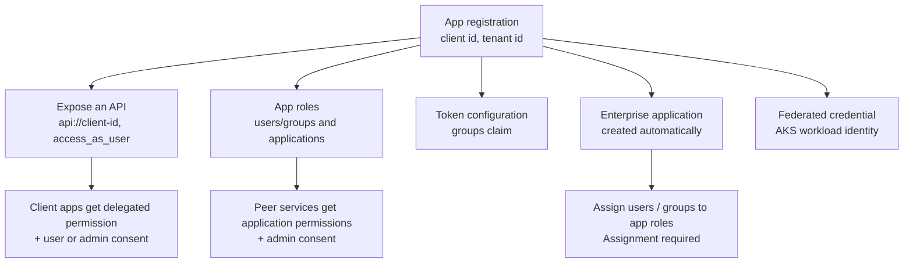

# Onboarding a service in Entra ID

What to set up in the Entra admin center before the starter can accept tokens for your API.

## App registration

1. **App registrations → New registration**, single tenant. Note the **Application (client) ID** (`client-id`)
   and the **Directory (tenant) ID** (`tenant-id`).
2. **Expose an API.** Set the Application ID URI to `api://<client-id>` and add a delegated scope such as
   `access_as_user`.
3. Optional but recommended: in the **Manifest**, set `"requestedAccessTokenVersion": 2`. The starter accepts
   v1 and v2 tokens either way.

## App roles

**App roles → Create app role** for each permission:

| Display name | Value | Allowed member types | Used by |
| --- | --- | --- | --- |
| Orders writer | `ORDERS_WRITE` | Users/Groups | users, through the enterprise app |
| Orders sync | `Orders.Sync` | Applications | peer services (client credentials) |

Use the values directly (`@Secured("ROLE_ORDERS_WRITE")`) or map them with `app-role-mappings`
(`"[Orders.Sync]": [ORDERS_SYNC]`).

## Groups claim

**Token configuration → Add groups claim.** Choose *Security groups*, or better *Groups assigned to the
application*, which keeps tokens small and avoids overage. For the access token keep *Group ID*, or emit names
(`sAMAccountName` for synced groups, or cloud-only display names) and map names instead.

For users in more than 200 groups, grant the API's registration the Microsoft Graph **application** permission
`GroupMember.Read.All` (admin consent), set `graph.overage-enabled=true` and configure a `credential`.

## Enterprise application

The registration creates an enterprise application (service principal) in your tenant.

- **Users and groups → Add user/group** assigns app roles to users or groups. They show up in the `roles` claim.
- **Properties → Assignment required = Yes** lets only assigned users and apps get tokens for the API.

## Consent

- **Client apps (users).** The client app's registration adds **API permissions → My APIs → your API → Delegated →
  access_as_user**. Users consent on first sign-in, or an admin grants consent for the tenant.
- **Peer services.** In the peer's registration add **API permissions → My APIs → your API → Application
  permissions → Orders.Sync**, then **Grant admin consent**. For managed identities, create the
  `appRoleAssignedTo` assignment with Graph or the CLI. The peer requests `api://<api-client-id>/.default`.
- **On-behalf-of.** Your API's registration needs delegated permissions to the downstream API. List the client
  app under `knownClientApplications` in your API's manifest to get combined consent in one prompt.

Optionally, trust specific callers by client id with `client-role-mappings`, and set
`service.require-known-client=true` to allow only those.

## Workload identity (AKS)

1. Enable the OIDC issuer and workload identity on the cluster.
2. Add a federated credential to the app registration (or user-assigned managed identity) for
   `system:serviceaccount:<namespace>:<service-account>`.
3. Annotate the service account with `azure.workload.identity/client-id` and label the pods with
   `azure.workload.identity/use: "true"`. See [deployment.md](deployment.md).
