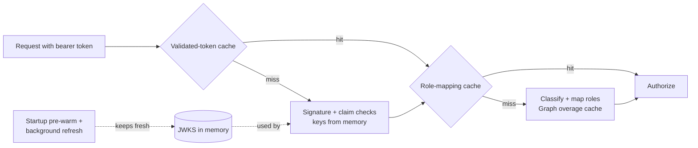

# Performance

Budget: authentication work must never take more than **300 ms**. Target: **under 5 ms** once warm.



## What keeps requests fast

| Mechanism | Default | Property |
|---|---|---|
| JWKS loaded while the application starts | on | `entra.security.cache.jwks-prewarm` |
| JWKS refreshed in the background before it expires (a daemon timer, so even idle services stay warm) | 5 min before the 15 min TTL | `entra.security.cache.jwks-refresh-ahead`, `entra.security.cache.jwks-ttl` |
| Validated tokens remembered (SHA-256 key, never past `exp` + clock skew, failures never cached) | 5 min, 10 000 entries | `entra.security.cache.validated-token-ttl`, `...validated-token-max-entries` |
| Principal + role mapping per token, including the Graph overage result | 5 min, 10 000 entries | `entra.security.cache.authentication-ttl`, `...authentication-max-entries` |
| Graph overage results per user | 10 min | `entra.security.graph.cache-ttl` |
| Outbound and Graph app tokens renewed in the background inside the refresh window | on, 5 min skew | `entra.security.cache.token-background-refresh`, `entra.security.cache.token-refresh-skew` |
| One pooled keep-alive JDK `HttpClient` for token, Graph, discovery and introspection calls | shared | - |
| Outbound connect / read timeouts | 2 s / 3 s | `entra.security.http.connect-timeout`, `entra.security.http.read-timeout` |

No request waits for a JWKS fetch: the keys are in memory before the first request, and they are replaced in the
background before they expire. Only a token signed with a `kid` that is not in the cached set causes a refresh,
rate-limited to one every 30 seconds.

**Trade-off.** A validated token stays accepted from the cache for up to `validated-token-ttl` even if Entra
removes its signing key in the meantime. Entra rotates keys with weeks of overlap, so 5 minutes is safe; set it to
`0` to turn the cache off.

## Measured numbers

`ValidationTimingTest` (in `entra-security-core`) runs the real decoder (RS256 signature, issuer, audience,
tenant and timestamp checks) and the real converter (classification and role mapping) 2 000 times after a
500-iteration warm-up, with the JWKS served once by a local mock.

Run on an 8-vCPU Intel Xeon build box, JDK 21:

| Scenario | p50 | p95 | p99 | max |
|---|---|---|---|---|
| First request after start (JWKS pre-warmed) | 0.68 ms | - | - | - |
| New token each time (signature + claims + roles) | 0.076 ms | 0.141 ms | 0.206 ms | 2.6 ms |
| Same token again (both caches hit) | 0.003 ms | 0.004 ms | 0.006 ms | 2.1 ms |

The test fails the build if the first request takes 300 ms or more, if new-token p99 reaches 50 ms, or if
cached p99 reaches 5 ms. The JWKS endpoint is called exactly once.

Run it yourself:

```bash
mvn -pl entra-security-core test -Dtest=ValidationTimingTest
```

In a running service, the `entra.security.auth.duration` timer and the `Server-Timing: auth;dur=…` header show
the same work per real request (see [observability.md](observability.md)).
