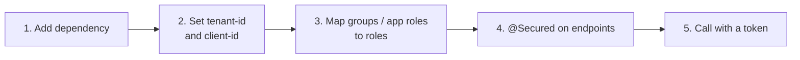

# Quickstart

Five minutes from an empty Spring Boot service to an API secured with Entra ID. You need the tenant id and the
API's client id from its app registration (see [onboarding.md](onboarding.md)).



## 1. Add the dependency

```xml
<dependency>
    <groupId>io.github.rmkr-dev</groupId>
    <artifactId>entra-security-spring-boot-starter</artifactId>
    <version>1.0.0</version>
</dependency>
```

Alongside `spring-boot-starter-webmvc`, or `spring-boot-starter-webflux` for a reactive service. A service that
injects `RestClient.Builder` also adds `spring-boot-starter-restclient`; one that injects `WebClient.Builder`
adds `spring-boot-starter-webclient`. Releases are
published to GitHub Packages; [releasing.md](releasing.md) shows the repository and token setup. To build from
source instead, run `mvn install` in this repository.

## 2. Configure

```yaml
entra:
  security:
    tenant-id: 00000000-0000-0000-0000-000000000000   # Directory (tenant) ID
    client-id: 11111111-1111-1111-1111-111111111111   # this API's Application (client) ID
    group-role-mappings:
      "aaaaaaaa-aaaa-aaaa-aaaa-aaaaaaaaaaaa": [ORDERS_READ]
```

Or with environment variables: `ENTRA_SECURITY_TENANTID`, `ENTRA_SECURITY_CLIENTID` and
`ENTRA_SECURITY_GROUPROLEMAPPINGSCOMPACT="aaaaaaaa-aaaa-aaaa-aaaa-aaaaaaaaaaaa=ORDERS_READ"`.

## 3. Secure endpoints

```java
@SpringBootApplication
@EnableEntraSecurity            // optional: pre-loads the JWKS and logs the effective config
public class OrdersApplication { ... }

@RestController
class OrderController {

    @GetMapping("/api/orders")
    @Secured("ROLE_ORDERS_READ")
    List<Order> list() { ... }

    @GetMapping("/api/me")
    EntraPrincipal me(EntraPrincipal caller) { return caller; }
}
```

Every path except `/actuator/health/**` and `/actuator/info` now needs a valid Entra token.
`@EnableEntraSecurity(failOnJwksError = true)` stops startup if the signing keys can't be loaded.

## 4. Try it

```bash
TOKEN=$(az account get-access-token --scope api://11111111-1111-1111-1111-111111111111/access_as_user \
        --query accessToken -o tsv)
curl -i -H "Authorization: Bearer $TOKEN" http://localhost:8080/api/orders
```

The Azure CLI has to be allowed to request tokens for your API (add it under **Expose an API → Authorized client
applications**, client id `04b07795-8ddb-461a-bbee-02f9e1bf7b46`), or get the token from any MSAL client.

You get `200`. Without the mapped group you get `403`, and without a token `401`. Both come back as
`application/problem+json`. The response also carries `Server-Timing: auth;dur=…`.

Next: [user flow](user-flow.md), [service-to-service](service-to-service.md),
[configuration](configuration.md), [deployment](deployment.md).
