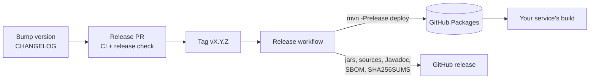

# Releases and installing from GitHub Packages



## Installing

Releases are published to GitHub Packages. GitHub's Maven registry needs a token even for public packages, so add
the repository and a server entry once.

`pom.xml`:

```xml
<repositories>
    <repository>
        <id>github-entra-security</id>
        <url>https://maven.pkg.github.com/rmkr-dev/spring-security-jwt-starter</url>
    </repository>
</repositories>
```

`~/.m2/settings.xml` (or the settings file your CI uses):

```xml
<servers>
    <server>
        <id>github-entra-security</id>
        <username>${env.GITHUB_ACTOR}</username>
        <password>${env.GITHUB_TOKEN}</password>
    </server>
</servers>
```

Locally, use a personal access token with the `read:packages` scope. In GitHub Actions, the workflow's
`GITHUB_TOKEN` works when the job has `packages: read` permission. With an internal mirror (Artifactory, Nexus,
Azure Artifacts), proxy that URL once and keep your normal settings.

Each GitHub release also carries the jars, sources and Javadoc jars, a CycloneDX SBOM per module
(`*-sbom.cdx.json`) and `SHA256SUMS`, for teams that vendor artifacts or scan dependencies.

## Cutting a release

1. Open a release PR that sets `<version>` in every `pom.xml`, moves `## [Unreleased]` in `CHANGELOG.md` to the
   new version and updates the version in the docs. CI runs the tests on Java 17, 21 and 25 and a release build check
   (`mvn -Prelease package`: sources, Javadoc and SBOM).
2. Merge it, then tag the merge commit and push the tag:

   ```bash
   git tag -a v1.0.0 -m "v1.0.0" && git push origin v1.0.0
   ```

3. The `Release` workflow checks that the tag matches the project version, runs `mvn -Prelease verify`, deploys
   the parent, core, starter and test modules to GitHub Packages and attaches the files to the GitHub release.
   The sample applications are never deployed.

To rebuild an existing tag, run the workflow by hand with that tag. Leave `publish` off for a dry run that only
builds and keeps the files as a workflow artifact.
