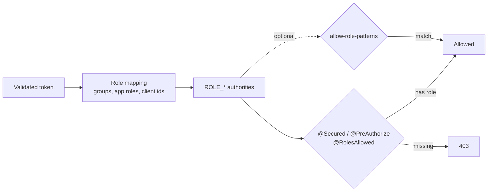

# Role patterns and @Secured



## Prefer `@Secured`

Put the required role on each endpoint. It is explicit, it shows up in code review, and the audit line shows the
roles the caller had.

```java
@GetMapping("/orders")
@Secured("ROLE_ORDERS_READ")
List<Order> orders() { ... }
```

| Annotation | Servlet | WebFlux | Use it for |
|---|---|---|---|
| `@Secured("ROLE_X")` | yes | yes (added by the starter) | Default choice: one or more roles, readable in review |
| `@PreAuthorize("hasRole('X') and ...")` | yes | yes | Conditions on arguments or the principal |
| `@RolesAllowed("X")` | yes | no | JSR-250 codebases on servlet only |

Roles are mapped from groups, app roles and client ids ([user-flow.md](user-flow.md),
[service-to-service.md](service-to-service.md)).

## Role-pattern allow (off by default)

For a few operator roles that should open every API (for example an internal hardware support team), list
patterns instead of adding the role to every `@Secured`:

```yaml
entra:
  security:
    authorization:
      allow-role-patterns:
        - "*hardware*"                 # glob: * any characters, ? one character
        - "regex:ops\\.(admin|oncall)" # Java regex, after the regex: prefix
      allow-role-patterns-case-sensitive: false   # default
```

- Patterns must match the whole mapped role name, with or without the `ROLE_` prefix. Scopes are never matched.
- A caller with any matching role passes `@Secured`, `@PreAuthorize`, `@PostAuthorize` and `@RolesAllowed`, on
  servlet and WebFlux. `@PreFilter`/`@PostFilter` still apply.
- URL rules are unchanged: the default chain already requires authentication only.
- The application logs a WARN at startup while patterns are configured, an INFO line the first time a role opens a
  given method, and every such request has `reason=role_pattern` in its audit line.
