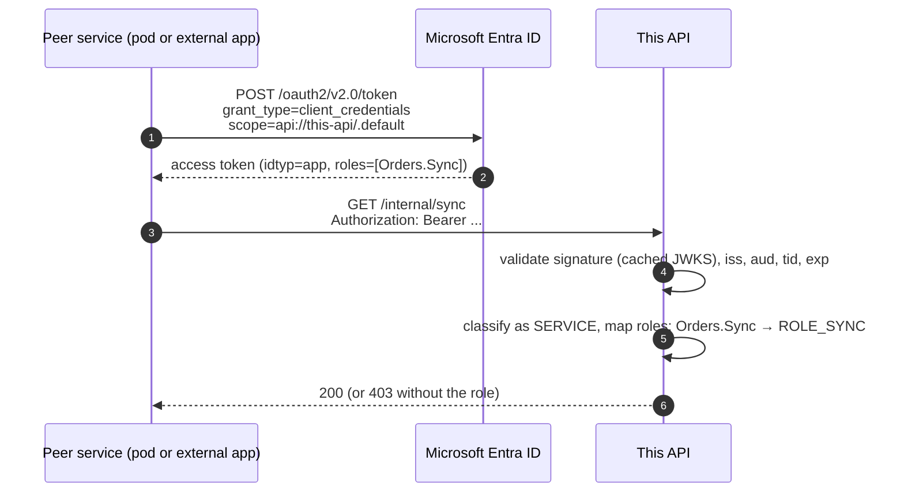
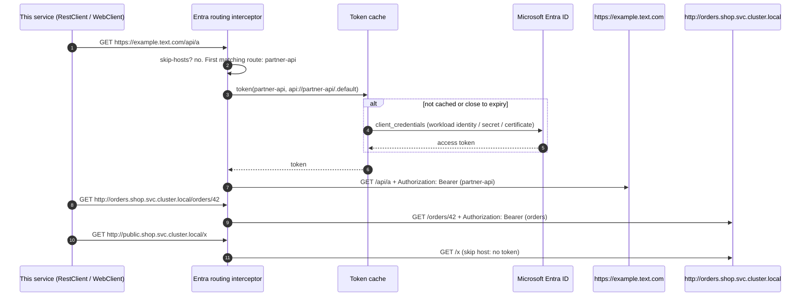

# Service-to-service calls

This page covers services calling each other with app-only tokens, both inside the cluster and to
external HTTPS APIs. Inbound, this service accepts tokens from peers and maps their app roles. Outbound,
it gets client-credentials tokens and attaches the right one to each request.

## Inbound: accepting tokens from peer services

A peer pod or an external application gets a token for this API with the client-credentials grant
(`scope=api://<this-api-client-id>/.default`). The token has `idtyp=app`, no `scp`, and a `roles` claim
listing the app roles the peer was assigned in **Enterprise applications → this API → Users and groups**
(for applications: **API permissions → Add → My APIs → Application permissions**, then admin consent).



Map app roles to Spring authorities and protect the endpoint:

```yaml
entra:
  security:
    app-role-mappings:
      "[Orders.Sync]": [SYNC]          # app role value → ROLE_SYNC
    client-role-mappings:              # optional: trust a specific caller by client id
      44444444-4444-4444-4444-444444444444: [REPORTS]
```

```java
@GetMapping("/internal/sync")
@Secured("ROLE_SYNC")
String sync() { ... }
```

Prefer app roles over `client-role-mappings`. Roles are assigned in Entra, can be audited there, and
apply to every caller that holds them. A client id mapping is useful for a single well-known caller.

## Outbound: one client, the right token for each host

Define an outbound client for each peer (credential and scope), then add **routes** that map URLs or
hosts to those clients. Spring Boot's `RestClient.Builder` and `WebClient.Builder` get a routing
interceptor or filter, so a single client bean can call every peer:

```yaml
entra:
  security:
    credential:                        # default credential for all outbound clients
      type: workload-identity          # or client-secret, certificate, key-vault-certificate
    outbound:
      clients:
        partner-api:
          scope: api://partner-api/.default
        orders:
          scope: api://orders-api/.default
        inventory:
          scope: api://inventory-api/.default
          credential:                  # per-client override
            type: certificate
            certificate-path: /var/run/secrets/inventory/client.pem
      routes:
        - urls: ["https://example.text.com/api/**"]
          client: partner-api
        - hosts: ["orders.shop.svc.cluster.local", "orders.shop.svc"]
          client: orders
        - name: shop-read
          hosts: ["*.shop.svc.cluster.local"]
          paths: ["/stock/**"]
          client: inventory
          scope: api://inventory-api/Stock.Read   # optional scope for this route
      skip-hosts:
        - public.shop.svc.cluster.local
        - "*.blob.core.windows.net"
```

```java
@Bean
RestClient peers(RestClient.Builder builder) {
    return builder.build();            // routes are already applied
}

String a = peers.get().uri("https://example.text.com/api/a").retrieve().body(String.class);
String o = peers.get().uri("http://orders.shop.svc.cluster.local/orders/42").retrieve().body(String.class);
```



### Matching rules

- The first route that matches wins. Requests that match no route are sent **without** a token, so
  tokens never leak to hosts you didn't list.
- `urls` are patterns such as `https://example.text.com/api/**` or `http://*.shop.svc.cluster.local:8080/**`.
  The scheme must match exactly, the host may start with `*.`, the port is optional (no port matches any
  port) and the path is an Ant-style pattern. A pattern without a path matches every path.
- `hosts` take an exact host, `*.domain` (any host below `domain`, not `domain` itself) or `*`, with an
  optional `:port`. `paths` restrict them. Hosts always match over `https`. Plain `http` matches only for
  in-cluster names (`*.svc`, `*.svc.cluster.local`) and loopback, unless the route sets `allow-http: true`
  (`false` refuses `http` everywhere). Sending a bearer token over plain http outside the cluster exposes
  it to anyone on the path.
- `skip-hosts` always win over routes. Use them for public endpoints inside a wildcard, or for storage
  and CDN hosts that use other credentials such as SAS URLs.
- A request that already has an `Authorization` header is left unchanged.
- Host names are compared case-insensitively, with a trailing dot ignored.

### Without the builder customizers

Set `entra.security.outbound.customize-builders=false` and apply the routing yourself:

```java
RestClient client = RestClient.builder().requestInterceptor(outbound.routingInterceptor()).build();
WebClient web = WebClient.builder().filter(EntraWebClientSupport.routingFilter(outbound)).build();
RestTemplate template = new RestTemplateBuilder().additionalInterceptors(outbound.routingInterceptor()).build();
```

A single named client still works without routes:
`builder.requestInterceptor(outbound.interceptor("orders"))`.

### Credentials

Each outbound client uses `entra.security.credential` unless it sets its own `credential.*`:

| Type | Typical use | Settings |
|------|-------------|----------|
| `workload-identity` | AKS with Azure Workload Identity | Uses the webhook-injected `AZURE_FEDERATED_TOKEN_FILE`, `AZURE_CLIENT_ID`, `AZURE_TENANT_ID`, or `credential.federated-token-file` / `client-id` / `tenant-id` |
| `client-secret` | Local development, simple deployments | `credential.client-secret` from a Kubernetes Secret |
| `certificate` | No shared secrets | `credential.certificate-path` (PEM or PKCS#12) and `certificate-password` |
| `key-vault-certificate` | Certificates rotated in Key Vault | `credential.key-vault.*`; reloaded periodically |

Tokens are cached per client and scope, and renewed `cache.token-refresh-skew` (5 minutes by default)
before they expire.

### On-behalf-of routes

A route can point at a client with `flow: on-behalf-of`. The request then carries a token for the calling
user, exchanged from the incoming token. See the on-behalf-of section of the [README](../README.md). A route `scope` is
used in place of the client's delegated scopes.

## Testing locally

The integration test `EntraServiceToServiceIntegrationTest` resolves `example.text.com` and
`*.shop.svc.cluster.local` to loopback through a JDK hosts file (`-Djdk.net.hosts.file`). It serves
`example.text.com` over HTTPS with a throwaway certificate generated by keytool, and calls this service
through `orders.shop.svc.cluster.local`, so the routed token is validated and mapped through app roles
end to end. The JDK resolver honours the hosts file; Reactor Netty's own DNS resolver doesn't, so the
test uses the JDK HTTP client.
