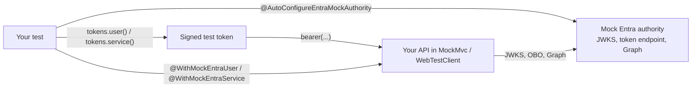

# Testing your service



Add the test module next to the starter:

```xml
<dependency>
    <groupId>io.github.rmkr-dev</groupId>
    <artifactId>entra-security-test</artifactId>
    <version>0.7.0</version>
    <scope>test</scope>
</dependency>
```

It gives you two ways to test `@Secured` endpoints, and neither needs a real tenant or network access.

## Real tokens against a mock authority

`@AutoConfigureEntraMockAuthority` starts an in-process authority on a random loopback port (one per JVM, so
Spring's context cache keeps working) and points `entra.security.authority-host`, `jwk-set-uri` and
`graph.base-url` at it. Tokens are signed with its RSA key, so the full pipeline runs: signature, issuer,
audience, tenant, expiry, role mapping and the Graph lookup on group overage.

```java
@SpringBootTest
@AutoConfigureMockMvc
@AutoConfigureEntraMockAuthority
class OrderApiTest {

    @Autowired MockMvc mvc;
    @Autowired EntraTestTokens tokens;          // bound to your tenant-id and client-id
    @Autowired EntraMockAuthority authority;

    @Test
    void readersCanList() throws Exception {
        mvc.perform(get("/api/orders").with(bearer(tokens.user().groups(READERS_GROUP))))
           .andExpect(status().isOk());
    }

    @Test
    void peersCanSync() throws Exception {
        mvc.perform(post("/internal/orders/sync").with(bearer(tokens.service().appRoles("Orders.Sync"))))
           .andExpect(status().isOk());
    }

    @Test
    void usersInManyGroupsAreResolvedThroughGraph() throws Exception {
        authority.registerGroups(USER_OID, READERS_GROUP);
        mvc.perform(get("/api/orders").with(bearer(tokens.user().objectId(USER_OID).groupOverage())))
           .andExpect(status().isOk());
    }

    @Test
    void expiredTokensAreRejected() throws Exception {
        mvc.perform(get("/api/orders").with(bearer(tokens.user().groups(READERS_GROUP).expired())))
           .andExpect(status().isUnauthorized());
    }
}
```

`bearer(...)` comes from `EntraMockMvc`; outside MockMvc use `tokens.user().bearer()` as the
`Authorization` header value. The token builder covers what Entra emits:

| Builder call | Token |
| --- | --- |
| `tokens.user()` | v2 delegated token, `scp=access_as_user`, default `oid` and client |
| `tokens.service()` | v2 app-only token, `idtyp=app`, no `scp` |
| `.groups(...)`, `.appRoles(...)`, `.scopes(...)` | `groups`, `roles`, `scp` |
| `.objectId(...)`, `.appId(...)`, `.name(...)`, `.username(...)` | `oid`, `azp`/`appid`, `name`, `preferred_username`/`upn` |
| `.groupOverage()` | no `groups`, `_claim_names`/`_claim_sources` pointing at Graph |
| `.v1()` | `sts.windows.net` issuer, `appid`, `api://` audience, `ver=1.0` |
| `.expired()`, `.expiresIn(...)`, `.notBefore(...)` | lifetime |
| `.audience(...)`, `.issuer(...)`, `.tenantId(...)`, `.without(claim)` | negative tests |
| `.signedWithUnknownKey()`, `.signedWithHmac()` | signatures that must be rejected |

The authority also serves the token endpoint, so outbound clients and the Graph client get tokens without
any extra stubbing. Use `EntraMockAuthority.start()` directly (and close it) when you are not in a Spring test.

## On-behalf-of calls

The mock token endpoint also answers the on-behalf-of grant. It checks the assertion like Entra does (signed by
the mock authority, unexpired, a user token, issued to the requesting `client_id`) and returns a delegated token
for the same user: `aud` is the resource of the requested scope, `scp` the scope names, `azp` your API, and
`oid`, `sub`, `name` and `preferred_username` copied from the user's token. Point the downstream base URL at a
stub and assert on what arrives:

```java
@Test
void profileIsReadAsTheUser() throws Exception {
    mvc.perform(get("/api/profile").with(bearer(tokens.user().objectId(USER_OID))))
       .andExpect(status().isOk());
    assertThat(authority.onBehalfOfRequests()).isEqualTo(1);
}

@Test
void missingConsentIsA403() throws Exception {
    authority.requireConsent("api://profile-api");                 // a scope or a whole resource
    mvc.perform(get("/api/profile").with(bearer(tokens.user())))
       .andExpect(status().isForbidden())
       .andExpect(jsonPath("$.error").value("consent_required"));
}
```

`requireInteraction(scopeOrResource, claims)` answers `interaction_required` with a claims challenge,
`onBehalfOfTokenLifetime(...)` shortens token lifetimes for refresh tests, and `onBehalfOfRequestForms()` returns
the received forms with the assertion and secrets masked. `reset()` clears all of it. On-behalf-of needs a real
token: `@WithMockEntraUser` has none to exchange, so use `bearer(...)` for these tests.

## No token at all

For tests that only care about authorization, run the test as a user or a service:

```java
@Test
@WithMockEntraUser(groups = READERS_GROUP)
void readersCanList() throws Exception {
    mvc.perform(get("/api/orders")).andExpect(status().isOk());
}

@Test
@WithMockEntraService(appRoles = "Orders.Sync")
void peersCanSync() throws Exception {
    mvc.perform(post("/internal/orders/sync")).andExpect(status().isOk());
}
```

When the starter is in the test context, the annotation values go through the same
`EntraJwtAuthenticationConverter` as real requests, so your `group-role-mappings`, `app-role-mappings` and
`client-role-mappings` are tested too. `roles = "ADMIN"` adds `ROLE_ADMIN` on top. `EntraPrincipal`
injection, `@AuthenticationPrincipal` and `EntraPrincipals.current()` all work.

## WebFlux with `WebTestClient`

Everything above works for reactive services. Use `@AutoConfigureWebTestClient` instead of
`@AutoConfigureMockMvc` and `EntraWebTestClient.bearer(...)` instead of `EntraMockMvc.bearer(...)`:

```java
@SpringBootTest
@AutoConfigureWebTestClient
@AutoConfigureEntraMockAuthority
class OrderApiTest {

    @Autowired WebTestClient client;
    @Autowired EntraTestTokens tokens;

    @Test
    void readersCanList() {
        client.get().uri("/api/orders").headers(bearer(tokens.user().groups(READERS_GROUP))).exchange()
              .expectStatus().isOk();
    }

    @Test
    void othersGetA403ProblemDocument() {
        client.get().uri("/api/orders").headers(bearer(tokens.user())).exchange()
              .expectStatus().isForbidden()
              .expectBody().jsonPath("$.error").isEqualTo("insufficient_scope");
    }

    @Test
    @WithMockEntraService(appRoles = "Orders.Sync")
    void peersCanSync() {
        client.post().uri("/internal/orders/sync").exchange().expectStatus().isOk();
    }
}
```

`@WithMockEntraUser` and `@WithMockEntraService` run through `ReactiveEntraJwtAuthenticationConverter` in a
WebFlux application, so the mappings are tested there too.
