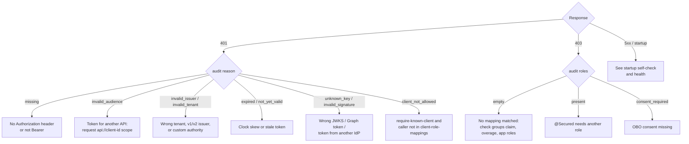

# Troubleshooting

Start with the status code, the `error` in the problem document, and the `reason` in the audit line.

## 401 Unauthorized

| Audit `reason` | Likely cause | Fix |
| --- | --- | --- |
| `missing` | No `Authorization: Bearer` header | Send the token. Public paths are only `public-paths`. |
| `invalid_audience` | The client asked for a token for another resource (often Microsoft Graph) | Request `api://<client-id>/.default` or `api://<client-id>/access_as_user`. Add custom audiences to `audiences`. |
| `invalid_issuer`, `invalid_tenant` | Token from another tenant, or a sovereign/B2C authority | Check `tenant-id`. For custom authorities set `authority.*` or turn on discovery ([configuration.md](configuration.md)). |
| `expired`, `not_yet_valid` | Old token, or the node clock is off | Get a new token. Raise `clock-skew` only for genuine drift. |
| `unknown_key`, `invalid_signature` | A Graph token (it can't be validated by third parties), a token from another IdP, or the wrong `jwks-uri` | Request a token for this API. Check `authority.jwks-uri`. |
| `malformed` | Not a JWT. Opaque tokens need a remote check | See [validation-modes.md](validation-modes.md). |
| `client_not_allowed` | `service.require-known-client=true` and the caller's `azp`/`appid` isn't listed | Add it to `client-role-mappings`. |
| `not_access_token` | `validation.reject-id-tokens=true` and the token has no `idtyp`, `scp` or `roles` | Send an access token for this API, not an ID token. Leave the flag off only if you intentionally accept ID tokens. |
| `invalid_tenant` | `tid` is not the configured tenant, or not in `multi-tenant.tenant-ids` when that flag is on | Check `tenant-id`. For several directories set `multi-tenant.enabled=true` and list the GUIDs. |

Decode the token (locally, never on a public site) and compare `aud`, `iss`, `tid`, `ver`, `idtyp`, `scp` and
`roles` with your configuration.

## 403 Forbidden

- **`roles` in the audit line is empty.** No mapping matched. Check that the groups claim is configured
  ([onboarding.md](onboarding.md#groups-claim)). Check whether the user hit group overage: then you need
  `graph.overage-enabled=true`, a credential and `GroupMember.Read.All`, and a warning in the log tells you Graph
  failed. Check that app roles are assigned on the enterprise app.
- **Roles are present but wrong.** `@Secured("ROLE_X")` needs exactly `ROLE_X`. Unmapped app roles become
  `ROLE_<value>` with the original case, so `Orders.Sync` becomes `ROLE_Orders.Sync` unless you map it.
- **`error=consent_required` or `interaction_required`.** An on-behalf-of call needs consent or MFA. The client app
  has to sign in interactively ([on-behalf-of.md](on-behalf-of.md)).
- **WebFlux `@Secured` ignored.** Reactive method security only applies to methods returning `Mono`/`Flux`.

## Startup self-check

`entra.security.self-check.mode` is `warn` by default and `fail` is recommended in production. It reports:

- `... is not a GUID` for tenant, client and outbound client ids
- `no audience: set entra.security.client-id or entra.security.audiences`
- a JWKS that returns no keys, or an introspection endpoint that isn't reachable
- `no credential (set entra.security.credential.type or the client's credential.type)`,
  `credential.type=client-secret but client-secret is empty`, and
  `credential.type=certificate but no certificate-path or key-vault certificate-name`

Other startup failures name the property: bad compact mappings, invalid authority URLs, unknown route clients, a
wrong certificate password, a missing Azure SDK for `key-vault-certificate`.

## Outbound calls carry no token

- No route matched. Requests that match no route are sent without a token on purpose.
- The host is in `skip-hosts`, or the request already had an `Authorization` header.
- Plain `http` to a host outside the cluster. Only `*.svc`, `*.svc.cluster.local` and loopback match over http
  unless the route sets `allow-http`.
- You built the client yourself and `outbound.customize-builders=false`. Add `outbound.routingInterceptor()`.

## Slow requests

Look at `Server-Timing: auth;dur=…` and `entra.security.auth.duration`. A warm request should take well under
1 ms ([performance.md](performance.md)). Slow outliers usually come from group overage (Graph latency, see
`entra.security.graph.lookups`), from remote validation modes, or from a token with a new `kid` that triggers a
JWKS refresh.

## Health is DOWN

`entraJwks` DOWN with `reason=unreachable` means the pod can't reach the authority, so check egress and proxy
settings. `entraGraph` DOWN with `reason=unauthorized` means the credential works but lacks the Graph permission or
admin consent.
