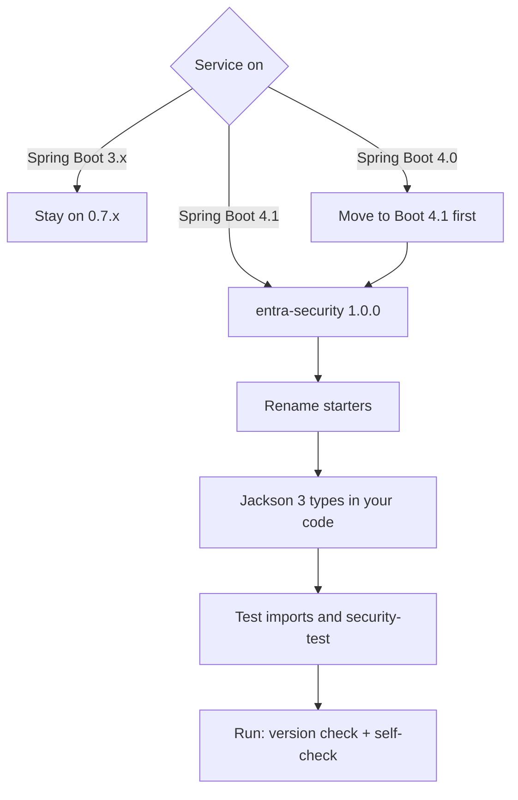

# Upgrading from 0.7.x to 1.0

1.0 is the Spring Boot 4.1 line. 0.7.x is the last line for Spring Boot 3.x. The `entra.security.*` properties,
`@Secured` roles, `EntraPrincipal` and the test annotations are unchanged, so most of the work is the Spring Boot
upgrade itself.



## Steps

1. **Spring Boot 4.1.** Upgrade the service to Spring Boot 4.1.x and Java 17 or later, following Spring Boot's own
   migration guide. Spring Boot 4.0 is not supported (see [compatibility.md](compatibility.md)).
2. **Version.** Set `entra-security-spring-boot-starter` and `entra-security-test` to `1.0.0`.
3. **Starters.** Switch to the Spring Boot 4 starter names listed in
   [compatibility.md](compatibility.md#starters-to-use). Add `spring-boot-starter-restclient` or
   `spring-boot-starter-webclient` if the service injects `RestClient.Builder` or `WebClient.Builder`.
4. **Jackson 3.** Problem responses use the application's `tools.jackson.databind.json.JsonMapper`. A custom
   `com.fasterxml.jackson.databind.ObjectMapper` bean no longer shapes them; customise the `JsonMapper` instead.
5. **Tests.** Add `spring-boot-starter-security-test` (test scope) for `@WithMockEntraUser` and
   `@WithMockEntraService`, and update the moved imports:

   | 0.7.x (Boot 3) | 1.0 (Boot 4.1) |
   | --- | --- |
   | `org.springframework.boot.test.autoconfigure.web.servlet.AutoConfigureMockMvc` | `org.springframework.boot.webmvc.test.autoconfigure.AutoConfigureMockMvc` |
   | `org.springframework.boot.test.autoconfigure.web.reactive.AutoConfigureWebTestClient` | `org.springframework.boot.webtestclient.autoconfigure.AutoConfigureWebTestClient` |
   | `com.fasterxml.jackson.databind.*` | `tools.jackson.databind.*` |
   | `org.springframework.boot.actuate.health.Health` | `org.springframework.boot.health.contributor.Health` |

6. **Start it.** The Spring Boot version check and the [startup self-check](troubleshooting.md#startup-self-check)
   report anything left over.

## Behaviour changes

| Area | 0.7.x | 1.0 |
| --- | --- | --- |
| WebFlux `@RolesAllowed`, `@PermitAll`, `@DenyAll` on `Mono`/`Flux` methods | ignored | enforced, like `@Secured` |
| Actuator health on WebFlux | blocking indicators | reactive `entraJwks` and `entraGraph` indicators, same names |
| Wrong Spring Boot line | `ClassNotFoundException` at startup | one clear startup error (below) |

New properties (`validation.reject-id-tokens`, `cache.bounded`, `multi-tenant.enabled`) are off by default, so an
unchanged configuration behaves as it did on 0.7.x. No property was renamed or removed.

## Spring Boot version check

The starter registers an `ApplicationContextInitializer` that runs before any auto-configuration. On a Spring Boot
line older than 4.1 it stops startup:

```text
java.lang.IllegalStateException: entra-security 1.x needs Spring Boot 4.1.x but this application runs Spring Boot
3.5.16. Use entra-security 0.7.x on Spring Boot 3.x, or upgrade the application (see docs/upgrading.md).
```

On a newer, untested line (4.2, 5.x) it logs one WARN and carries on. Set
`entra.security.self-check.spring-boot-version=false` to skip the check, for example while trying a Spring Boot
milestone.
