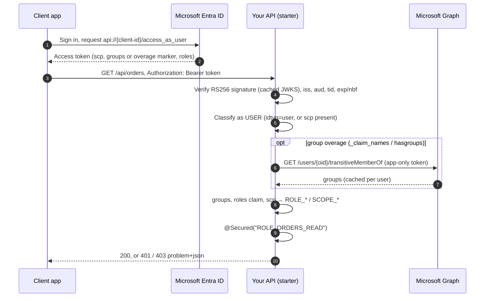

# User flow

A user signs in to a client app (SPA, mobile or web app), which then calls your API with a delegated access token.

## Classification

A token is a **user** token when `idtyp=user`, or when `idtyp` is absent and `scp` is present. Everything else is
handled as a [service](service-to-service.md) token.

## Where roles come from

| Source | Mapping | Result |
| --- | --- | --- |
| `groups` claim (object ids, or names when Entra emits `sAMAccountName` or cloud display names) | `group-role-mappings` (case-insensitive) | the mapped roles |
| `roles` claim (app roles assigned to the user or their group on the enterprise app) | `app-role-mappings`, otherwise `ROLE_<value>` | when `user.include-roles-claim=true` (default) |
| `scp` claim | none | `SCOPE_<scope>` when `user.include-scopes=true` |
| every user | `user.default-roles` | the listed roles |

Use the roles with `@Secured("ROLE_X")` (preferred), `@PreAuthorize("hasRole('X')")` or `@RolesAllowed`.

## Group overage

When a user is in more groups than fit in a JWT (200), Entra leaves out `groups` and adds
`_claim_names: {"groups": ...}` (or `hasgroups: true`). With `graph.overage-enabled=true` the starter reads the
user's transitive groups from Microsoft Graph with an app-only token. That needs a `credential` and the
`GroupMember.Read.All` application permission. The result is cached per user for `graph.cache-ttl`, and both ids
and display names are mapped. If Graph fails, the request carries on without group roles (fail closed), a warning
is logged, and the failed result is not cached.

To avoid overage altogether, emit *Groups assigned to the application* in the groups claim (see
[onboarding.md](onboarding.md#groups-claim)).
