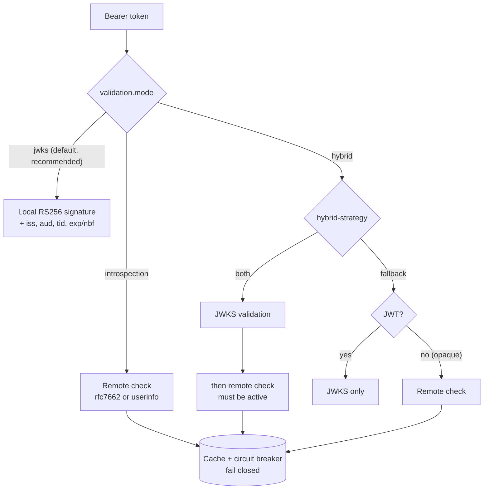

# Validation modes

`entra.security.validation.mode` picks how inbound tokens are checked.



## Be honest about Entra

**Microsoft Entra ID has no RFC 7662 introspection endpoint.** Entra access tokens are JWTs meant to be validated
locally against the tenant JWKS. `jwks` is the recommended mode for Entra tokens, and the fastest
(see [performance.md](performance.md)).

The remote modes exist for setups that put something else in front of the API:

- `introspection.type=rfc7662` (the default type) is for a gateway or custom authorization server that does
  expose RFC 7662.
- `introspection.type=userinfo` presents the token to a userinfo-style endpoint (Graph `/oidc/userinfo` by default,
  or `/v1.0/me`). It only works for tokens whose audience is Microsoft Graph, and it proves who the user is, **not**
  that the token was issued for this API.

If a remote mode is configured without an endpoint and discovery finds none, startup fails and the message says
exactly this.

## Modes

| Mode | What happens | Use it when |
| --- | --- | --- |
| `jwks` | Local signature and claim checks with the cached JWKS. | Entra tokens. Always, unless you have a reason not to. |
| `introspection` | Every token goes to the remote check. The JWKS preload and JWKS health check are skipped. | A gateway issues opaque or non-Entra tokens. |
| `hybrid` + `both` | JWKS validation, then the remote check must say the token is active. | You need revocation from a gateway on top of JWKS. |
| `hybrid` + `fallback` | JWTs are checked with JWKS, opaque tokens remotely. A JWT that fails JWKS is never retried remotely. | Mixed traffic. |

## Remote check settings

```yaml
entra:
  security:
    validation:
      mode: hybrid
      hybrid-strategy: both
      introspection:
        type: rfc7662
        uri: https://gateway.example.com/oauth2/introspect   # default: discovered introspection_endpoint
        auth-method: client-secret-basic                     # client-secret-post, bearer, none
        client-id: 11111111-1111-1111-1111-111111111111
        # client-secret from a Secret (defaults to credential.client-secret)
        positive-cache-ttl: 5m
        negative-cache-ttl: 10s
        failure-threshold: 5
        open-duration: 30s
```

- Results are cached by a SHA-256 hash of the token. Active results are kept until min(`exp`, `positive-cache-ttl`)
  and inactive ones for `negative-cache-ttl`.
- After `failure-threshold` consecutive failures the circuit opens for `open-duration`. Uncached tokens are then
  rejected with 401, so the check fails closed.
- `validate-claims` (default `true`) applies the same issuer, audience, tenant and time rules to the returned
  claims. `claims-mapping` renames fields: by default `scope` → `scp` and `client_id` → `azp`. For userinfo,
  `id` → `oid`, `userPrincipalName` → `preferred_username` and `displayName` → `name`.
- Each call is timed as `entra.security.introspection.requests{result}`.
